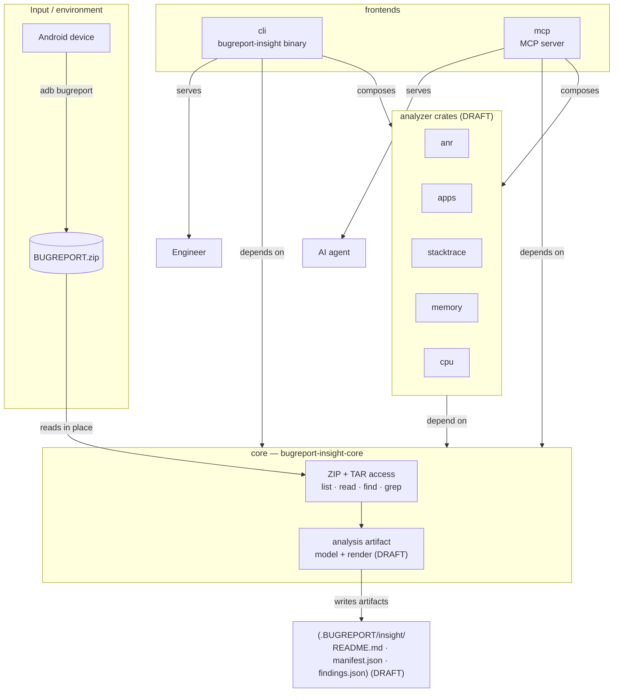

# Architecture

## Architecture Overview

`bugreport-insight` is a read-only analysis tool organized as a Cargo workspace around a single shared foundation crate (`core`), thin analyzer crates, and two independent frontends: a CLI for engineers and an MCP server for AI agents. It has no network access, no database, and no persistent server — it turns one ZIP archive into a folder of findings.

Every element in this diagram carries an ID of its own, so the diagram is traceable down to
[`requirement-diagram.md`](./requirement-diagram.md) and from there into
[`traceability-matrix.md`](./traceability-matrix.md). A `(DRAFT)` label means the element is only
required by `DRAFT-`-prefixed requirements and is not being built now; an unlabelled element is
committed. The mapping is given in [Element-to-Requirement Map](#element-to-requirement-map).

- **`core`** owns all archive access — ZIP and TAR listing, reading, finding, and grepping — plus the analysis artifact model and rendering. Every other crate depends on `core` to read bugreports and emit artifacts. `core` itself depends on `ripgrep`, `zip`, and `tar`.
- **Analyzer crates** (`anr`, `apps`, `stacktrace`, `memory`, `cpu`) each own one kind of scanner and depend on `core`. All five are draft.
- **`cli`** is the `bugreport-insight` binary for engineers. It depends on `clap` for argument parsing, plus `core` and the analyzer crates.
- **`mcp`** is the MCP server for AI agents. It depends on `rmcp`, plus `core` and the analyzer crates.

## Crate Responsibilities and Dependencies

| ID | Crate | Role | Depends on | Status |
| --- | --- | --- | --- | --- |
| [`ARCH-CORE`](./traceability-matrix.md#arch-core) | `core` | Read-only ZIP + TAR access (list, read, find, grep); analysis artifact model and rendering | `ripgrep`, `zip`, `tar` | mixed |
| [`ARCH-ANR`](./traceability-matrix.md#arch-anr) | `anr` | Application Not Responding scanner | `core` | 🚧 draft |
| [`ARCH-APPS`](./traceability-matrix.md#arch-apps) | `apps` | Installed/running app inventory (PID, package, data/install paths) | `core` | 🚧 draft |
| [`ARCH-STACKTRACE`](./traceability-matrix.md#arch-stacktrace) | `stacktrace` | Native crashes/tombstones and Java stack traces | `core` | 🚧 draft |
| [`ARCH-MEMORY`](./traceability-matrix.md#arch-memory) | `memory` | Memory pressure and low-memory-killer scanner | `core` | 🚧 draft |
| [`ARCH-CPU`](./traceability-matrix.md#arch-cpu) | `cpu` | CPU/I-O pressure and lock-contention scanner | `core` | 🚧 draft |
| [`ARCH-SUPPORT`](./traceability-matrix.md#arch-support) | `support` | Shared clap args and JSON-emit helper for analyzer binaries | `clap`, `serde`, `serde_json` | 🚧 draft |
| [`ARCH-CLI`](./traceability-matrix.md#arch-cli) | `cli` | The `bugreport-insight` CLI binary | `clap`, `core`, analyzer crates | mixed |
| [`ARCH-MCP`](./traceability-matrix.md#arch-mcp) | `mcp` | MCP server for AI-agent-driven inspection | `rmcp`, `core`, analyzer crates | ✅ committed |

`ARCH-CORE` is **mixed**: its archive-access half is committed and required by `REQ-GEN-01`,
`REQ-GEN-02`, and the seven `REQ-MCP-ARC-*` tools, while its artifact-model half is draft under
`DRAFT-REQ-GEN-04` and `DRAFT-REQ-ART-*`. The crate is one unit in Cargo, so it ships as one unit;
the split is a statement about which obligations are committed, not about two crates.

`ARCH-CLI` is **mixed** for the same reason: `--mcp`, `--help`, and `--verbose` are committed
(`REQ-CLI-03`, `REQ-CLI-04`, `REQ-CLI-05`), while the analyze command and the seven toggles are draft.

## Element-to-Requirement Map

The `Traceability` column links to the row in [`traceability-matrix.md`](./traceability-matrix.md)
where the same ID appears beside the requirements it serves.

| Diagram element | ID | Traceability | Status |
| --- | --- | --- | --- |
| `ZIP + TAR access` (archive half of `core`) | [`ARCH-CORE-ARC`](./traceability-matrix.md#arch-core-arc) | `REQ-GEN-01`, `REQ-GEN-02`, `REQ-MCP-ARC-01` … `07`, `REQ-MCP-03` | ✅ |
| `analysis artifact model + render` | [`ARCH-CORE-ART`](./traceability-matrix.md#arch-core-art) | `DRAFT-REQ-GEN-04`, `DRAFT-REQ-ART-01` … `08` | 🚧 |
| `anr`, `apps`, `stacktrace`, `memory`, `cpu` | [`ARCH-ANR`](./traceability-matrix.md#arch-anr) … [`ARCH-CPU`](./traceability-matrix.md#arch-cpu) | `DRAFT-REQ-GEN-03`, `DRAFT-REQ-CLI-02`, `06` … `11`, `DRAFT-REQ-MCP-{ANR,APP,CRS,MEM,CPU}-01` | 🚧 |
| `cli` binary | [`ARCH-CLI`](./traceability-matrix.md#arch-cli) | `REQ-CLI-03`, `04`, `05` committed; `DRAFT-REQ-CLI-01`, `02`, `06` … `11` draft | mixed |
| `mcp` server | [`ARCH-MCP`](./traceability-matrix.md#arch-mcp) | `REQ-MCP-01` … `10` | ✅ |
| MCP tool surface | [`ARCH-MCP-TOOLS`](./traceability-matrix.md#arch-mcp-tools) | `REQ-MCP-ARC-01` … `07`; `DRAFT-REQ-MCP-ANR-01`, `APP-01`, `CRS-01`, `MEM-01`, `CPU-01` | mixed |

## Dependency Rules

- `core` is the sole foundation: it depends only on external crates (`ripgrep`, `zip`, `tar`) and never on any sibling workspace crate.
- Analyzer crates and frontends (`cli`, `mcp`) depend on `core`; `core` never depends back on them, so there is no dependency cycle.
- The two frontends are peers: `cli` serves engineers over a command line, `mcp` serves AI agents over the Model Context Protocol. Neither depends on the other.

## What Is Committed Now

Only three obligations are committed, and the design above is arranged so the committed part stands
alone:

1. **Reading and grepping the ZIP** — `REQ-GEN-01`, `REQ-GEN-02`. This is `core`'s archive half,
   `ARCH-CORE-ARC`. No analyzer is required to read a ZIP.
2. **The MCP server** — `REQ-MCP-01` … `10` and the seven `REQ-MCP-ARC-*` tools. `ARCH-MCP` depends on
   `core` and `rmcp` only for these; the five analyzer tools it also exposes are draft.
3. **The `--mcp`, `--help`, and `--verbose` options** — `REQ-CLI-03`, `04`, `05`.

Everything else in this document is draft, and `DRAFT-`-prefixed requirements are not
traceability evidence. See [`requirements.md`](./requirements.md) for what the prefix means.