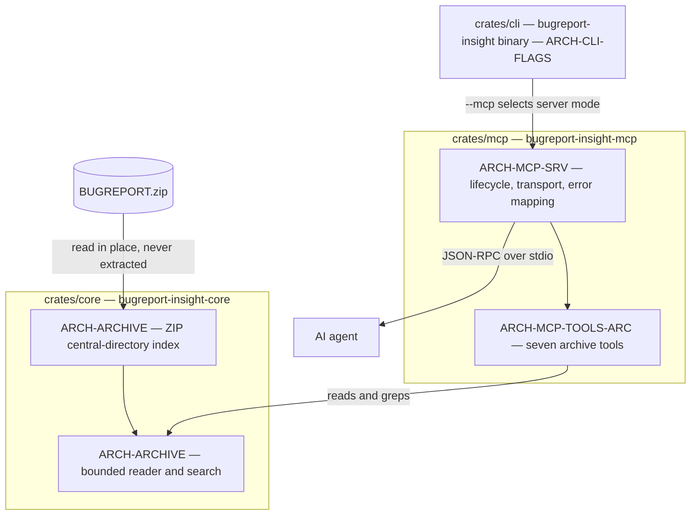

# Architecture

## 1. Scope and authority

This document is the source of truth for **what the implementation is made of**: crates, elements,
their IDs, their dependencies, and their status. [`requirements.md`](./requirements.md) is the source
of truth for *what the tool must do*; [`design/`](./design/index.md) is the source of truth for *why
the design is shaped this way*.

**Where they disagree, `docs/` wins for scope and `docs/design/` wins for reasoning.** The one place
that rule bites today is crate naming — the design set still says `crates/archive`, the manifest
says `crates/core`. §3 records the mapping; the manifest is authoritative.

Every element ID below originates here and is listed in
[`traceability-matrix.md`](./traceability-matrix.md#architecture-elements). The link runs both ways.

## 2. Architecture overview

`bugreport-insight --mcp <archive.zip>` is a **read-only MCP server over stdio**. One process, one
archive opened in place, no network, no database, no extraction, no persistence. Three crates.

<!-- `componentDiagram` is the correct UML type for this view, but mermaid-svg 0.7.0 — the
     project's syntax gate — rejects it with "unknown diagram type". Rendered as `flowchart`
     instead. See design/09-open-items.md §4. -->


**stdout carries JSON-RPC frames and nothing else.** Any `println!` outside the transport is a
build-blocking defect, enforced by a grep assertion in the test suite. Diagnostics go to **stderr**
via `eprintln!`; `tracing-subscriber` is not in the offline cache, and `eprintln!` cannot reach
stdout by construction.

## 3. Elements

Fourteen live elements: **four committed, ten draft.** Every element carries exactly one status.
Draft propagates: an element serving any draft requirement is itself draft, which is why a crate
is never half-committed.

### 3.1 Committed

| ID | Crate | Role | Depends on | Status |
| --- | --- | --- | --- | --- |
| <a id="arch-archive"></a>[`ARCH-ARCHIVE`](./traceability-matrix.md#arch-archive) | `crates/core` | ZIP central-directory index; bounded line, byte-range, and content search; content detection; archive identity | `zip`, `serde`, `serde_json`, `thiserror`, `sha2`, `grep-searcher`, `grep-regex`, `grep-printer` | ✅ |
| <a id="arch-mcp-srv"></a>[`ARCH-MCP-SRV`](./traceability-matrix.md#arch-mcp-srv) | `crates/mcp` | Server lifecycle, stdio transport, `ArchiveError` → wire error mapping | `bugreport-insight-core`, `serde`, `serde_json`, `thiserror`, `tokio`, `rmcp` | ✅ |
| <a id="arch-mcp-tools-arc"></a>[`ARCH-MCP-TOOLS-ARC`](./traceability-matrix.md#arch-mcp-tools-arc) | `crates/mcp` | The seven archive tools behind the `ToolHandler` trait | `bugreport-insight-core`, `serde`, `serde_json` | ✅ |
| <a id="arch-cli-flags"></a>[`ARCH-CLI-FLAGS`](./traceability-matrix.md#arch-cli-flags) | `crates/cli` | The `bugreport-insight` binary: `--mcp`, `--help`, `--verbose` | `clap`; hands off to `crates/mcp` on `--mcp` | ✅ |

**Crate-name mapping.** `ARCH-ARCHIVE` is the *capability* ID fixed by
[`03-id-scheme.md` §3](./design/03-id-scheme.md#3-family-2--arch-). The crate that will hold it is
`crates/core`, package `bugreport-insight-core`, because that is what the manifest and the
pre-existing directory say. The design set's `crates/archive` / `bugreport-insight-archive` is
stale naming, not a different design.

### 3.2 Draft — recorded, not built

None of these are in the workspace, and none may be implemented against.

| ID | Crate | Role | Status |
| --- | --- | --- | --- |
| <a id="draft-arch-core-art"></a>[`DRAFT-ARCH-CORE-ART`](./traceability-matrix.md#draft-arch-core-art) | `crates/core` | Analysis-artifact model and rendering | 🚧 |
| <a id="draft-arch-cli-cmd"></a>[`DRAFT-ARCH-CLI-CMD`](./traceability-matrix.md#draft-arch-cli-cmd) | `crates/cli` | `analyze` command and seven analyzer toggles | 🚧 |
| <a id="draft-arch-mcp-res"></a>[`DRAFT-ARCH-MCP-RES`](./traceability-matrix.md#draft-arch-mcp-res) | `crates/mcp` | MCP resource surface | 🚧 |
| <a id="draft-arch-mcp-tools-analysis"></a>[`DRAFT-ARCH-MCP-TOOLS-ANALYSIS`](./traceability-matrix.md#draft-arch-mcp-tools-analysis) | `crates/mcp` | Five analyzer tools | 🚧 |
| <a id="draft-arch-anr"></a>[`DRAFT-ARCH-ANR`](./traceability-matrix.md#draft-arch-anr) | — | ANR scanner | 🚧 |
| <a id="draft-arch-apps"></a>[`DRAFT-ARCH-APPS`](./traceability-matrix.md#draft-arch-apps) | — | App inventory scanner | 🚧 |
| <a id="draft-arch-stacktrace"></a>[`DRAFT-ARCH-STACKTRACE`](./traceability-matrix.md#draft-arch-stacktrace) | — | Tombstone and Java stack-trace scanner | 🚧 |
| <a id="draft-arch-memory"></a>[`DRAFT-ARCH-MEMORY`](./traceability-matrix.md#draft-arch-memory) | — | Memory-pressure and LMK scanner | 🚧 |
| <a id="draft-arch-cpu"></a>[`DRAFT-ARCH-CPU`](./traceability-matrix.md#draft-arch-cpu) | — | CPU / I-O pressure scanner | 🚧 |
| <a id="draft-arch-support"></a>[`DRAFT-ARCH-SUPPORT`](./traceability-matrix.md#draft-arch-support) | — | Shared CLI and JSON plumbing | 🚧 |

The five analyzer elements and `DRAFT-ARCH-SUPPORT` were the `subcommand-*` crates. **That approach
is dropped** — they are not in `Cargo.toml` and are not coming back in this form. Their IDs are
retained because IDs are never reused and a withdrawn element keeps its ID
([`03` §8](./design/03-id-scheme.md#8-link-targets)).

## 4. Crate dependency rules

- `crates/core` depends only on external crates. It never depends on a workspace sibling.
- `crates/mcp` depends on `crates/core`. Never the reverse.
- `crates/cli` depends on nothing but `clap` in the committed scope; it selects server mode by
  handing control to `crates/mcp`. It is a peer of `crates/mcp`, not a parent.
- Therefore there is no cycle, and no crate can reach an `rmcp` symbol except `crates/mcp`'s
  adapter module.

## 5. The seven tools and the `ToolHandler` seam

`ARCH-MCP-TOOLS-ARC` is exactly seven tools, and it is the reason the committed scope is buildable
at all:

| Tool | Answers | Touches bytes? |
| --- | --- | --- |
| `archive_info` | Am I looking at the archive I think I am? | no — index + memoised digest |
| `list_entries` | What is here, with sizes? | no |
| `find_entries` | Which paths match a pattern? | no |
| `entry_info` | Everything about one entry. | no — index + detect |
| `find_by_type` | Which paths are of this content type? | no — index + detect |
| `read_entry` | A bounded slice of one entry. | **yes** |
| `grep_archive` | Content search, returning locators. | **yes** |

```rust
// crates/mcp/src/registry.rs — zero rmcp symbols in this module
pub trait ToolHandler: Send + Sync {
    fn name(&self) -> &'static str;
    fn description(&self) -> &'static str;
    fn call(&self, params: serde_json::Value) -> Result<ToolEnvelope, ToolError>;
}
/// Exactly seven, sharing one `Arc<Archive>`.
pub fn registry(ctx: Arc<Archive>) -> Vec<Box<dyn ToolHandler>>;
```

> **Deviation from the shape first recorded here.** `registry()` originally took no arguments and
> each handler was a unit struct. A unit struct has nowhere to put the archive, and the alternative
> — a thread-local, or a second global — is worse than a parameter. `ctx` is the same
> `Arc<Archive>` for all seven, so there is still exactly one index, one digest cache, and no lock.
> The trait signature is unchanged.

The `rmcp` adapter is one file that wraps each handler in `#[tool]` and implements `ServerHandler`.
**Zero tool logic is rewritten when it lands.** Because the seam carries no protocol types, all
seven tools — and the four-way status matrix below — are unit-testable with no server running. That
is what lets the tool work proceed in parallel with the blocked `rmcp` fetch.

**Addressing.** Every tool addresses entries by `entry_id: u32` (`EntryId`). **Paths are output,
never input.** This removes path traversal, encoding mismatch, duplicate entry names, and
glob-versus-literal ambiguity in one move ([`systemPatterns.md` §4](./../.memory-bank/systemPatterns.md)).

### Two constraints the schema imposes, found the hard way

**`read_entry` uses four flat fields, not a Rust enum.** `REQ-MCP-ARC-04` wants exactly one of two
range pairs, and modelling the call as an externally-tagged enum expresses that perfectly. It also
produces an `inputSchema` with no root `"type"`, and rmcp **panics** `tools/list` on that rather
than degrading — a schema the MCP specification does not permit. So `ReadEntryParams` is a flat
struct with `line_start`, `line_end`, `byte_start`, and `byte_end`, all optional, and the
mutual exclusion is a check returning `conflicting_range_params` (a variant `core` already
provides). The constraint is real; only the encoding changed.

**Malformed parameters reach the caller as a tool error, not a JSON-RPC error.**
[`design/05-mcp-server-design.md`](./design/05-mcp-server-design.md) §4 puts them in the protocol
class. rmcp's `#[tool]` wrapper deserialises `Parameters<T>` itself and converts the failure into
`isError: true`, so the caller sees *which* field was wrong — more useful than the opaque rendering
the design anticipated. The handler's protocol-error path is still live and carries the errors rmcp
does not intercept: `conflicting_range_params` and `pattern_mode_unavailable`.

## 6. Structural constraints

These are not preferences. Each one is forced, and each is cheap to get wrong.

### 6.1 No lock anywhere

One immutable `Arc<ArchiveIndex>`, built once at startup by walking the central directory. Five of
the seven tools are pure functions over it and touch no handle and no lock, ever. `read_entry` and
`grep_archive` open a **fresh reader handle per call**. The server holds no `Mutex` and no `RwLock`.

### 6.2 Two passes, because the borrow checker demands it

`ZipArchive::by_index` returns a guard that **borrows** the archive. Two live borrows in one scope
is `E0499`. The metadata pass and the content pass must therefore be separate: borrow, extract,
drop, borrow again.

### 6.3 Reading line N is O(1) in memory — the most bug-prone part

The reference archive's main entry has **682,951 lines**, one of them **192,666 characters** long.
`MAX_LINE_BYTES = 1 MiB` is sized above that worst case.

The line-skip must **count `\n` through a 64 KiB scratch buffer**. It must never call
`reader.lines()` or `read_line()` into a `String`, both of which allocate per line and blow up on a
192 KB line. When a line exceeds `MAX_LINE_BYTES`, return `ExcerptOutcome::LineTooLong` with the
true `byte_len_full`, and **skip the remainder by counting newlines — never buffer the tail.**
Reading line _N_ of a 682,951-line entry costs O(1) memory, not O(file).

### 6.4 Result status is never conflated

`ArchiveStatus` is a committed four-value enum defined in `crates/core`, beside `ArchiveError`:
`Ok`, `Empty`, `NotFound`, `Unreadable`. A tool failure is **never** shaped like a successful empty
result. `Empty` is reachable only when the tool completed and found nothing; `Unreadable` when the
thing exists and could not be read. Domain failures are returned as tool errors carrying a stable
`code`, because that is what lets an agent recover — for example with the `entry_id` to retry.

`NotFound` is reserved for exactly one cause: **the addressed thing does not exist**. A range past
the end of an entry is therefore `Unreadable`, not `NotFound` — the entry is there, the read is
impossible, and reporting `NotFound` would claim the entry is absent, which is the confusion
`REQ-MCP-08` exists to prevent.

### 6.5 Bounded, never silently truncated

Every limit is a hard error or an explicit `stopped_reason`. A lying header is caught by the
streaming guard, never by trusting the declared size. A lying central directory is caught at open.

**`omitted_count` and coverage are different units, and reporting only the first is a lie by
omission.** `omitted_count` counts withheld *matches*. When a budget stops a scan early, whole
*entries* go unsearched — a different quantity, and one the server cannot even count in matches
because it never looked. Reporting only `omitted_count` lets `truncated: true, omitted_count: 0`
read as "capped but nothing was lost" while a third of the archive was never searched.

So `grep_archive` reports coverage separately and unconditionally:

| Field | Meaning |
| --- | --- |
| `scanned_entries` | Entries actually read |
| `entries_in_scope` | What the call asked for — the scope, or the whole archive when unscoped |
| `entries_not_searched` | `entries_in_scope - scanned_entries` |
| `coverage_complete` | `entries_not_searched == 0` |

and a stopped scan also carries a `note` naming the gap and the remedy. An agent can now see that
its zero results are provisional rather than a fact about the archive.

**A scan that stops early is never `Empty`.** `empty` asserts the tool completed and there was
nothing to find; a stalled scan knows neither. It reports `ok` with `truncated: true`.

`data` keeps one shape across statuses — `{matches, scan}` whether the result is `ok` or `empty` —
so a caller branching on `status` never has to special-case the empty result to find `matches`.

## 7. Reference archive — measured, load-bearing

| Property | Value |
| --- | --- |
| SHA-256 | `10ec0b47dd7934462b6bbaa1e02e5bf47698f0f22368c93e37b2de020239df92` |
| Size | 14,710,126 bytes |
| Entries | 398 (0 directories, 0 encrypted, 0 unreadable) |
| Uncompressed total | 126,631,335 bytes (≈8.6×) |
| Main entry | `…-2026-09-24-00-27-17.txt`, 64,645,191 bytes, **682,951 lines** |
| Longest line, archive-wide | **192,666 characters** |
| Archive-wide line count | **1,243,691** |
| Line length p50 / p99 | 83 / 325 |

Measured on the host 2026-10-05 by walking the ZIP with Python's `zipfile`; every entry decompressed
without error. Every bound in §6.3 is sized from these numbers, so they are design inputs, not trivia.

> **One figure corrected.** Earlier notes record the archive-wide line count as **1,243,790**. Counting
> `\n` across all 398 entries yields **1,243,691**; counting `split('\n')` fragments yields 1,244,089.
> Neither reproduces 1,243,790, so the earlier figure is not reproducible by either convention and is
> treated here as wrong. The main entry's 682,951 lines **is** confirmed exactly, and it is the number
> §6.3 is sized against, so no bound changes. `techContext.md` still carries the old figure.

## 8. Dependency availability — verified 2026-10-05

Every row below was established by `cargo build --offline`, not by reading a manifest. Both
blockers recorded earlier in this section are **resolved**, and the vendor directory they were
about is no longer in use — see the subsection below for why, which is the more interesting part.

| Dependency | In `Cargo.toml` | Builds offline | Note |
| --- | --- | --- | --- |
| `zip 2.2` (resolves 2.4.2, `deflate` only) | ✅ | ✅ | |
| `serde`, `serde_json`, `thiserror` | ✅ | ✅ | |
| `clap 4.5` | ✅ | ✅ | **`default-features = false`** — see below |
| `grep-matcher 0.1.9`, `grep-regex 0.1.14`, `grep-searcher 0.1.17`, `grep-printer 0.3.1` | ✅ | ✅ from the registry | transitive chain resolves normally |
| `grep-pcre2 0.1.10` | ✅ | ⚠️ needs system `libpcre2-8` | unused unless `PatternMode::Regex` ships |
| `rmcp 3.5.0` | ✅ | ✅ from the registry | `features = ["server", "transport-io"]` |
| `schemars 1.2.2` | ✅ | ✅ | rmcp's own dependency, declared directly in `crates/mcp` |
| `sha2 0.10.9` | ✅ | ✅ | pinned in `crates/core`; `ring` → `sha2` per open item 17 |
| `tokio 1` | ✅ | ✅ | `crates/mcp` and `crates/cli` |
| `tracing-subscriber` | ❌ | ❌ absent | **intended** — diagnostics use `eprintln!` |

### The vendor directory is no longer in use — by decision

`.cargo/config.toml` replaced `crates-io` with a directory at
`/Users/p2p/scm/local/tmp/bugreport-insight/vendor`. **That configuration was deleted**, and the
project now builds from the ordinary cargo registry cache with no machine-local path anywhere. The
absolute path was the portability liability, and removing it is the fix, not an accident.

Two problems surfaced on the way out, and both are traps worth naming.

**1. The vendored checksums were fabricated.** Every `.cargo-checksum.json` in the vendor directory
recorded a `package` value that did not match the SHA-256 of the real `.crate` tarball — 294 of 374
were wrong. A directory source verifies `package` against crates.io *only when cargo is allowed to
consult the registry*, so every `--offline` build passed while a plain `cargo build` failed with
`checksum for X changed between lock files`. Repaired by `scripts/repair_vendor_checksums.py`, which
recomputes `package` from the cached tarball and falls back to `null` — a supported value meaning
"locally vendored, do not check against the registry" — when no tarball exists.
`scripts/check_vendor_checksums.py` re-checks the directory against `Cargo.lock`. The directory
itself is retained, with correct checksums, should an offline workflow ever be wanted again.

**2. rust-analyzer invoked cargo without `--offline`, and loaded nothing.** It therefore hit the
checksum failure, fell back to a project with **zero** dependency source, and reported type errors
against code that compiles. The tell was in its own output:

```bash
~/.cargo/bin/rust-analyzer analysis-stats . --run-all-ide-things
#   dependency lines of code: 2_008_281, item trees: 4_525   <- healthy
#   dependency lines of code: 0, item trees: 0                <- what it looked like
```

If an editor reports type errors in code that `cargo check --all-targets` accepts, check
`analysis-stats` for `dependency lines of code: 0` before believing it. The failure is in the
tool's environment, not the code.

### What this means for portability

The build is now ordinary: a clone that can reach crates.io needs no configuration at all. A clone
that cannot still needs a vendor directory — rebuilt with correct checksums, which the repair
script makes mechanical. The alternative remains dropping `grep-*` for `regex` + `globset`; not
taken, and recorded here only as the fallback.

Two crates (`arbitrary`, `derive_arbitrary`) carry `package: null` because their tarballs were never
successfully cached. Harmless while the vendor directory is unused.

### `clap` disables its default features

`clap`'s default feature set pulls `anstream`, whose `wincon` feature requires `anstyle-wincon`.
That crate is Windows-only and is absent from the vendor directory, and cargo requires every
package in the lockfile to resolve regardless of target — so with default features the build fails
at resolution.

`clap` is therefore declared with `default-features = false` and an explicit feature list. The
upside is independent of the workaround: **this server's stdout is a protocol channel**
(`REQ-MCP-10`), and ANSI colour on a JSON-RPC stream would corrupt frames for any client that
piped one into the other.

## 9. Superseded IDs — Rule R-ID-3

These keep their original unprefixed form forever. Per R-ID-3 a retired element's status is recorded
in its row, never in its ID, so a historical record is never falsified by a later decision. Each of
these four once served both committed and draft requirements, and each has since been split into a
committed part and a draft part.

| Superseded ID | Status at retirement | Superseded by | Why |
| --- | --- | --- | --- |
| <a id="arch-core-arc"></a>[`ARCH-CORE-ARC`](./design/03-id-scheme.md#4-superseded-ids) | committed | `ARCH-ARCHIVE` | Split out of a crate whose artifact half is draft |
| <a id="arch-cli"></a>[`ARCH-CLI`](./design/03-id-scheme.md#4-superseded-ids) | committed and draft | `ARCH-CLI-FLAGS` + `DRAFT-ARCH-CLI-CMD` | Three committed flags, one draft command |
| <a id="arch-mcp"></a>[`ARCH-MCP`](./design/03-id-scheme.md#4-superseded-ids) | committed and draft | `ARCH-MCP-SRV` + `DRAFT-ARCH-MCP-RES` | `DRAFT-REQ-MCP-07` moved to its own element |
| <a id="arch-mcp-tools"></a>[`ARCH-MCP-TOOLS`](./design/03-id-scheme.md#4-superseded-ids) | committed and draft | `ARCH-MCP-TOOLS-ARC` + `DRAFT-ARCH-MCP-TOOLS-ANALYSIS` | Seven committed tools, five draft |

These four are **not** among the fourteen live elements in §3, and the anchors above exist so that
existing links to the retired IDs still resolve.

## 10. What is committed now

Only three obligations, and the structure above is arranged so the committed part stands alone:

1. **Reading and grepping the ZIP** — `ARCH-ARCHIVE`. No analyzer is required to read an archive.
2. **The seven archive tools and the MCP server** — `ARCH-MCP-TOOLS-ARC`, `ARCH-MCP-SRV`.
3. **The `--mcp`, `--help`, `--verbose` flags** — `ARCH-CLI-FLAGS`.

Everything else in this document is draft, and `DRAFT-`-prefixed requirements are not traceability
evidence. See [`requirements.md`](./requirements.md) for what the prefix means.

## 11. Verification

```bash
cd /Users/p2p/scm/local/copilot/copilot-worktrees/bugreport-insight/khoa-io-refactored-eureka
cargo metadata --offline --format-version 1      # exit 0
```

Three properties are asserted of this document and checked mechanically rather than inlined here,
so that the checks do not themselves introduce the strings they forbid: the two legacy dependency
claims named in [`design/09-open-items.md` §5](./design/09-open-items.md) are absent, the
single-status term is absent, and the fourteen live anchors match
[`traceability-matrix.md`](./traceability-matrix.md#architecture-elements) exactly.

Dependency availability in §8 was established by building each dependency in isolation, and
re-confirmed after the vendored source replacement was removed. **`cargo metadata` without
`--offline` still exits 101 here**, because it tries to download `arbitrary` and `derive_arbitrary`
and this sandbox blocks the write into `~/.cargo/registry`. That is an environment limit, not a
project defect — and rust-analyzer tolerates it: `analysis-stats` recovers and loads the full
dependency graph.