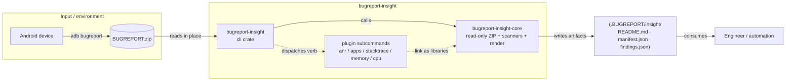

# Architecture Diagram

## Architecture Overview

`bugreport-insight` is a read‑only, single‑binary‑plus‑plugins architecture. The CLI binary links a shared core library (read‑only ZIP access, scanners, rendering) and a set of scanner libraries, and dispatches focused verbs to sibling binaries. It has no network access, no database, and no persistent server — it is a local analysis utility that turns one ZIP archive into a folder of findings.

