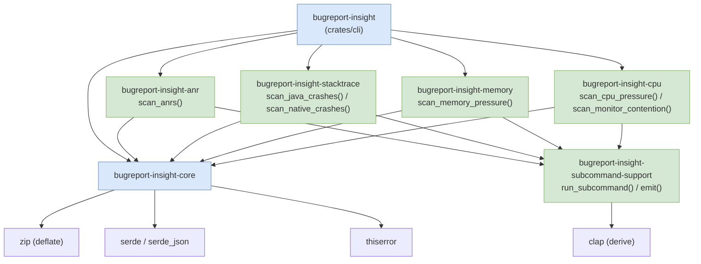

# Class Diagram

## Core Components

### Crate map



### Code structure

```text
crates/
├── core/                        # bugreport‑insight‑core (no CLI dependency)
│   └── src/
│       ├── analyze.rs           # open_report / unclaimed_findings / render_insight
│       ├── archive.rs           # read‑only ZIP + safety limits
│       ├── source.rs            # primary‑report selection
│       ├── render.rs            # artifact rendering
│       ├── model.rs             # Finding / Evidence / Session / Manifest / AppInfo
│       ├── sessions.rs          # reboot‑aware session segmentation
│       ├── error.rs             # Error enum
│       ├── text.rs              # bounded / markdown_escape / capitalize
│       └── scanners/
│           ├── mod.rs           # find_all / lookahead / unique_sample
│           ├── activity.rs      # scan_activity_timeline
│           ├── crash.rs         # scan_watchdog
│           └── performance.rs   # scan_broadcast_latency
├── cli/                         # bugreport‑insight binary
│   └── src/
│       ├── main.rs              # arg parsing + plugin dispatch entry
│       ├── cli.rs               # Cli (clap derive)
│       ├── plugin.rs            # git/cargo‑style subcommand dispatch
│       └── report.rs            # full‑report scanner composition
├── subcommand-support/          # shared CLI/JSON plumbing
│   └── src/lib.rs               # run_subcommand / emit / report_error
├── subcommand-anr/              # ANR scanner + binary
├── subcommand-apps/             # app inventory scanner + binary
├── subcommand-stacktrace/       # Java/native crash + tombstone scanner + binary
├── subcommand-memory/           # memory‑pressure scanner + binary
└── subcommand-cpu/              # CPU/I‑O + monitor‑contention scanner + binary
```
