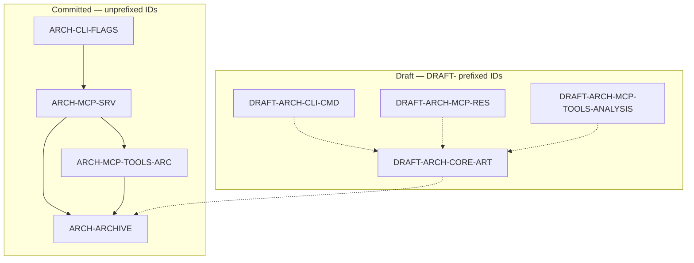

# 03 — ID scheme

**This is the file the two implementation engineers code and write against.** Every ID below is
final. Do not invent IDs; if one is needed, mint it under these rules and add it here.

Convention rules are in [`01` §5.1](./01-decision-record.md#51-the-draft--prefix-on-component-ids)
and [`01` §5.2](./01-decision-record.md#52-rule-r-id-3--a-superseded-id-never-changes-form).

## 1. The three families

| Family | Kind | Prefix rule |
| --- | --- | --- |
| `REQ-*` | Requirement | `DRAFT-` if not committed |
| `ARCH-*` | Architecture component | `DRAFT-` if every mapped requirement is draft |
| `UC-*` | Use case | `DRAFT-` if every mapped requirement is draft |

A fourth family, `DGM-*`, was proposed to name one file per diagram and is **retired unissued** — see
[§7](#7-family-4-dgm-retired-unissued).

Anchors drop the `DRAFT-` prefix: `DRAFT-ARCH-ANR` → `#draft-arch-anr`. This matches the
existing convention in `requirements.md`. `#` fragments cannot cleanly carry a leading
prefix, and `requirements.md` already lowercases and strips.

## 2. Committed versus draft

<!-- `componentDiagram` is the correct UML type here, but mermaid-svg 0.7.0 — the project's
     syntax gate — rejects it with "unknown diagram type: componentDiagram". Rendered as
     `flowchart` instead. See 09-open-items.md §4. Validated with target/doc-validate. -->

Solid edges are committed dependencies. Dashed edges point from a draft component at the
committed crate it will later extend — `DRAFT-ARCH-CORE-ART` will depend on `ARCH-ARCHIVE`;
nothing committed depends on a draft component.

**Counts: 13 live components — 4 committed, 9 draft.** There is no mixed status.

## 3. Family 2 — `ARCH-*`

### Committed

| ID | Element | Requirements |
| --- | --- | --- |
| `ARCH-ARCHIVE` | `crates/core` — ZIP list / read / find / grep *(was `crates/archive` when minted; see [`01` §5.3](./01-decision-record.md#53-the-deleted-crates-tree-is-intentional))* | `REQ-GEN-01`, `REQ-GEN-02`, `REQ-LIB-01`, `REQ-MCP-03`, `REQ-MCP-09`, `REQ-MCP-ARC-01` … `07` |
| `ARCH-MCP-SRV` | `crates/mcp` server core — lifecycle, transport, error mapping | `REQ-MCP-01` … `06`, `REQ-MCP-08`, `09`, `10`, `11` |
| `ARCH-MCP-TOOLS-ARC` | The seven archive tools | `REQ-MCP-ARC-01` … `07`, `REQ-MCP-05`, `REQ-MCP-06`, `REQ-MCP-08` |
| `ARCH-CLI-FLAGS` | `crates/cli` flag parsing — `--mcp`, `--help`, `--verbose` | `REQ-CLI-03`, `REQ-CLI-04`, `REQ-CLI-05` |

### Draft

| ID | Element | Requirements |
| --- | --- | --- |
| `DRAFT-ARCH-CORE-ART` | `crates/core` artifact model and rendering | `DRAFT-REQ-GEN-04`, `DRAFT-REQ-ART-01` … `08` |
| `DRAFT-ARCH-CLI-CMD` | `cli` analyze command and seven toggles | `DRAFT-REQ-CLI-01`, `02`, `06` … `11` |
| `DRAFT-ARCH-MCP-RES` | MCP resource surface | `DRAFT-REQ-MCP-07` |
| `DRAFT-ARCH-MCP-TOOLS-ANALYSIS` | Five analyzer tools | `DRAFT-REQ-MCP-ANR-01`, `APP-01`, `CRS-01`, `MEM-01`, `CPU-01` |
| `DRAFT-ARCH-ANR` | `anr` crate | `DRAFT-REQ-GEN-03`, `DRAFT-REQ-CLI-07`, `DRAFT-REQ-MCP-ANR-01` |
| `DRAFT-ARCH-APPS` | `apps` crate | `DRAFT-REQ-GEN-03`, `DRAFT-REQ-CLI-06`, `DRAFT-REQ-MCP-APP-01` |
| `DRAFT-ARCH-STACKTRACE` | `stacktrace` crate | `DRAFT-REQ-GEN-03`, `DRAFT-REQ-CLI-08`, `DRAFT-REQ-MCP-CRS-01` |
| `DRAFT-ARCH-MEMORY` | `memory` crate | `DRAFT-REQ-GEN-03`, `DRAFT-REQ-CLI-09`, `DRAFT-REQ-MCP-MEM-01` |
| `DRAFT-ARCH-CPU` | `cpu` crate | `DRAFT-REQ-GEN-03`, `DRAFT-REQ-CLI-10`, `DRAFT-REQ-MCP-CPU-01` |
| `DRAFT-ARCH-SUPPORT` | `support` shared CLI/JSON plumbing | `DRAFT-REQ-CLI-01`, `06` … `11` |

## 4. Superseded IDs

Per **Rule R-ID-3** ([`02` §2](./01-decision-record.md#54-dependency-rulings)),
these keep their original unprefixed form **forever**, whatever their successor's status.

| Superseded ID | Original status | Superseded by | Why |
| --- | --- | --- | --- |
| `ARCH-CORE-ARC` | committed | `ARCH-ARCHIVE` | Split out of a crate whose artifact half is draft; became its own crate |
| `ARCH-CLI` | mixed | `ARCH-CLI-FLAGS` + `DRAFT-ARCH-CLI-CMD` | Three committed flags, one draft command |
| `ARCH-MCP` | mixed | `ARCH-MCP-SRV` + `DRAFT-ARCH-MCP-RES` | `DRAFT-REQ-MCP-07` moved to its own element |
| `ARCH-MCP-TOOLS` | mixed | `ARCH-MCP-TOOLS-ARC` + `DRAFT-ARCH-MCP-TOOLS-ANALYSIS` | Seven committed tools, five draft |

**None of the four was ever draft**, so the R-ID-3 question is moot in practice. All four rows
stay in [`traceability-matrix.md`](../traceability-matrix.md) marked `superseded by`, per the
convention at `traceability-matrix.md:95`.

**`ACT-*` is retired.** No committed workflow exists to depict — "serve MCP over stdio" is a
state diagram, and it lives in `mcp-protocol.md` when that file is created.

## 5. Family 1 — `REQ-*`

**23 committed / 27 draft / 50 total**, changed from 22 / 24 / 46 by three added requirements
(`REQ-MCP-11`, `DRAFT-REQ-MCP-ARC-08`, `DRAFT-REQ-MCP-ARC-09`) and one reclassification.

### Committed — `docs/requirements.md`

`REQ-GEN-01`, `REQ-GEN-02`, `REQ-LIB-01`, `REQ-MCP-01` … `REQ-MCP-06`, `REQ-MCP-08`,
`REQ-MCP-09`, `REQ-MCP-10`, `REQ-MCP-ARC-01` … `REQ-MCP-ARC-07`, `REQ-CLI-03`, `REQ-CLI-04`,
`REQ-CLI-05`.

**The `REQ-MCP-01` … `06` range above covers `REQ-MCP-02`** — single-archive scope. It is never
written as the defective range `01 … 10`, which would silently pull in
`DRAFT-REQ-MCP-07`.

### Added by this design

| ID | Status | Purpose |
| --- | --- | --- |
| `REQ-MCP-11` | committed | `initialize` carries `instructions`: ≤ 40 lines naming each tool, its cost class, its bound, and the call order. Publishes no archive content. |
| `DRAFT-REQ-MCP-ARC-08` | draft | Pattern mode `Regex`. Split out of `REQ-MCP-ARC-03` / `-05` because it is blocked on the absent `regex` crate — [`02` §4.2](./01-decision-record.md#54-dependency-rulings). |

### Draft — `docs/requirements-draft.md` (planned)

`DRAFT-REQ-GEN-03`, `DRAFT-REQ-GEN-04`, `DRAFT-REQ-ART-01` … `DRAFT-REQ-ART-08`,
`DRAFT-REQ-MCP-07`, `DRAFT-REQ-MCP-ARC-08`, `DRAFT-REQ-MCP-ANR-01`, `DRAFT-REQ-MCP-APP-01`,
`DRAFT-REQ-MCP-CRS-01`, `DRAFT-REQ-MCP-MEM-01`, `DRAFT-REQ-MCP-CPU-01`, `DRAFT-REQ-CLI-01`,
`DRAFT-REQ-CLI-02`, `DRAFT-REQ-CLI-06` … `DRAFT-REQ-CLI-11`.

### Requirement rewrites required

Decided in [`01` §3](./01-decision-record.md#3-requirement-quality), not yet applied to
[`requirements.md`](../requirements.md):

| ID | Rewrite |
| --- | --- |
| `REQ-GEN-02` | Add the numeric limits — untestable as written |
| `REQ-MCP-06` | Add every bound; require the four bounding fields always present |
| `REQ-MCP-05` | Delete the untestable clause; state the `tools/list` regression test |
| `REQ-MCP-09` | Keep locator discipline; move the causal-claim clause to the draft analyzer requirements |
| `REQ-GEN-01`, `REQ-MCP-01`, `REQ-MCP-03`, `REQ-MCP-04`, `REQ-MCP-10` | See the table at [`01` §3.5](./01-decision-record.md#35-remaining-rewrites) |
| `REQ-MCP-ARC-02` | ZIP-only — drop "and TAR" |
| `REQ-MCP-ARC-04` | Two named mutually-exclusive range pairs; address by `entry_id` |
| `REQ-MCP-ARC-05` | Reclassify to `interfaceRequirement`; add `byte_offset` to every match |
| `REQ-MCP-ARC-06`, `-07` | Add the `ContentType` and `DetectionBasis` enums |
| `REQ-CLI-03` | Split the mangled bullet; move the output-directory sentence to `DRAFT-REQ-CLI-01` |

## 6. Family 3 — `UC-*`

| ID | Status | Actor | Requirements |
| --- | --- | --- | --- |
| `UC-01` | committed | Engineer / AI agent | `REQ-MCP-01` … `06`, `08` … `11`, `REQ-MCP-ARC-01` … `07`, `REQ-GEN-01`, `REQ-GEN-02`, `REQ-CLI-03` |
| `UC-02` | committed | AI agent | `REQ-MCP-ARC-04`, `05`, `06`, `07`, `REQ-MCP-06`, `08`, `09` |
| `DRAFT-UC-03` | draft | Engineer | `DRAFT-REQ-CLI-01`, `DRAFT-REQ-GEN-04`, `DRAFT-REQ-ART-01` … `08` |
| `DRAFT-UC-04` | draft | CI job | `DRAFT-REQ-CLI-01`, `DRAFT-REQ-GEN-04`, `DRAFT-REQ-ART-02` |
| `DRAFT-UC-05` | draft | Third-party developer | `DRAFT-REQ-GEN-03`, `DRAFT-REQ-CLI-02`, `06` … `11` |
| `DRAFT-UC-06` | draft | Researcher | `DRAFT-REQ-GEN-04`, `DRAFT-REQ-ART-02` |

`UC-01` is **enumerated, not ranged**. The existing range `REQ-MCP-01 … 10` at
`traceability-matrix.md:65` silently includes draft `DRAFT-REQ-MCP-07` — the defect that
prompted this whole restructure.

## 7. Family 4: DGM, retired unissued

The restructure originally proposed a fourth family of diagram indices, one per file, named
`docs/diagram-<ID>.md`: `DGM-ARCHIVE`, `DGM-SERVER`, `DGM-RES`, `DGM-CLI`, `DGM-ANALYSIS`,
`DGM-ARTIFACTS`.

**It was never minted, and no ID is now reserved.** The canvases ended up named by concern
instead — [`../diagrams/`](../diagrams/index.md) — which needs no new prefix and no new family. The
reasoning that would have justified leaving `DGM-*` unprefixed still holds and is worth keeping: a
diagram is a structural index into a document, not a component, so prefixing it would mark the
specification itself draft and destroy the ability to _specify_ draft work.

## 8. Link targets

Every ID is a link target in both directions. An element row in
[`traceability-matrix.md`](../traceability-matrix.md) links to the document that defines it, and
that document links back.

| Prefix | Lives in | Anchor form |
| --- | --- | --- |
| `REQ-*`, `DRAFT-REQ-*` | [`requirements.md`](../requirements.md) and [`draft/requirements.md`](../draft/requirements.md); indexed in [`diagrams/index.md`](../diagrams/index.md) | `#req-gen-01`, `#draft-req-gen-03` |
| `ARCH-*`, `DRAFT-ARCH-*` | [`architecture.md`](../architecture.md) | `#arch-archive`, `#draft-arch-anr` |
| `UC-*`, `DRAFT-UC-*` | [`use-cases.md`](../use-cases.md) | `#uc-01`, `#draft-uc-03` |
| `CLS-*`, `SEQ-*`, `ACT-*` | not redrawn; see [`../diagrams/index.md` §5](../diagrams/index.md#5-not-depicted) | — |

`CLS-*`, `SEQ-*`, and `ACT-*` remain unissued; no element carries them.

**No link in this design set points at an unlisted target.**

**IDs are stable.** An ID is never reused for a different thing, and a withdrawn element keeps
its ID with its row marked withdrawn or superseded.
