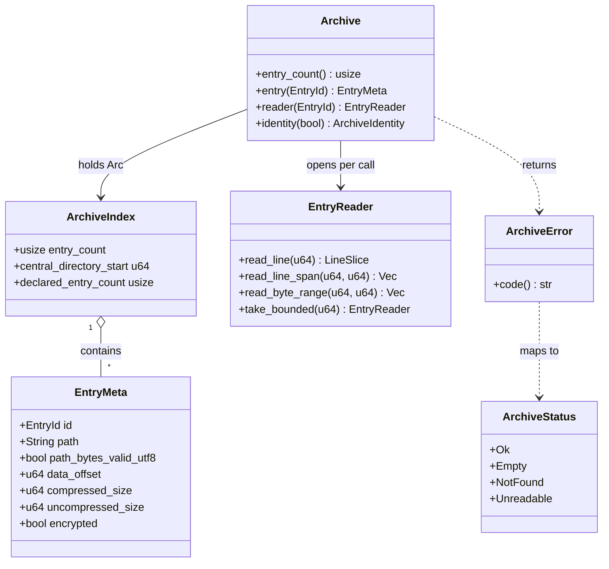

# 04a — `crates/archive` API: contract and errors

**Part 1 of 2.** The contract, limits, and error model. Continue with
[`04b-core-archive-types.md`](./04b-core-archive-types.md) for the entry, reader, detection,
search, and identity types.

**Engineer B codes against these two files without waiting.** Together they are the Stage 1 merge
artefact.

**Amended version.** `data_offset` is `u64` (not `Option<u64>`) and `ArchiveStatus` lives in
this crate (not in `crates/mcp`) — see
[`02` §5](./02-amendment-1.md#5-two-corrections-to-01-worth-restating).

```toml
# crates/archive/Cargo.toml
[package]
name = "bugreport-insight-archive"
version.workspace = true
edition.workspace = true

[dependencies]
serde = { workspace = true }
serde_json = { workspace = true }
thiserror = { workspace = true }
zip = { workspace = true }
ring = { workspace = true }   # SHA-256; swap to sha2 when the grant lands
```

No `regex`, no `globset`, no async. **This crate must not gain a draft dependency** — that is
what makes rule 1 a compile error instead of a review comment.

## Module layout



`ArchiveIndex "1" o-- "*" EntryMeta` — the index is immutable and shared; it holds no file
handle, no lock, and no interior mutability. This is what makes five of the seven tools pure
functions.

## `lib.rs`

```rust
//! Read-only, bounded Android bugreport ZIP access. Never extracts. No artifact knowledge.

pub mod archive;
pub mod caps;
pub mod detect;
pub mod error;
pub mod identity;
pub mod limits;
pub mod reader;
pub mod search;
pub mod text;

pub use archive::{Archive, ArchiveIndex, EntryId, EntryMeta, ScanRequest};
pub use caps::*;
pub use detect::{ContentType, DetectionBasis, DetectionReport, NestedKind};
pub use error::ArchiveError;
pub use identity::{ArchiveIdentity, ArchiveNote};
pub use limits::{ArchiveLimits, LimitViolation};
pub use reader::{EntryReader, LineSlice};
pub use search::{
    MatchKind, MatchLocator, PatternMode, ScanBudget, ScanOutcome, StoppedReason,
};
pub use text::{Excerpt, ExcerptOutcome, LineIndex, TextDecoding};
```

## `limits.rs`

```rust
/// Hard limits. Not configurable per run (REQ-GEN-02). Reject, never truncate.
#[derive(Debug, Clone, Copy)]
pub struct ArchiveLimits {
    pub max_entries: usize,          // 10_000
    pub max_entry_bytes: u64,        // 256 MiB, enforced on the DECOMPRESSED stream
    pub max_total_bytes: u64,        // 1 GiB, sum of uncompressed sizes
    pub max_archive_file_bytes: u64, // 2 GiB, stat(2) on the file itself
    pub max_compression_ratio: u64,  // 1_000, against the declared size
}

impl ArchiveLimits {
    pub const DEFAULT: Self = Self {
        max_entries: 10_000,
        max_entry_bytes: 256 * 1024 * 1024,
        max_total_bytes: 1024 * 1024 * 1024,
        max_archive_file_bytes: 2 * 1024 * 1024 * 1024,
        max_compression_ratio: 1_000,
    };
    pub fn validate(&self) -> Result<(), ArchiveError>;
}

#[derive(Debug, Clone, PartialEq, Eq)]
#[non_exhaustive]
pub enum LimitViolation {
    TooManyEntries { found: usize, limit: usize },
    EntryTooLarge  { entry_id: EntryId, found: u64, limit: u64 },
    TotalTooLarge  { found: u64, limit: u64 },
    FileTooLarge   { found: u64, limit: u64 },
    RatioExceeded  { entry_id: EntryId, ratio: u64, limit: u64 },
}

impl LimitViolation {
    /// Stable machine code. This is the contract; `Display` is prose.
    pub fn code(&self) -> &'static str;
    // "entries" | "entry_bytes" | "total_bytes" | "file_bytes" | "ratio"
}
```

## `error.rs`

```rust
#[derive(Debug, thiserror::Error)]
#[non_exhaustive]
pub enum ArchiveError {
    #[error("cannot open `{path}`: {source}")]
    Open { path: PathBuf, source: std::io::Error },

    #[error("not a ZIP archive: `{path}`")]
    NotAZipArchive { path: PathBuf },

    #[error("{0}")]
    LimitExceeded(#[from] LimitViolation),

    #[error("no entry with id {0}")]
    EntryNotFound(EntryId),

    #[error("entry {0} is a directory, not a file")]
    EntryIsDirectory(EntryId),

    #[error("entry {id} is encrypted")]
    EntryEncrypted { id: EntryId },

    #[error("entry {id} uses unsupported compression method {method} (code {code})")]
    UnsupportedCompression { id: EntryId, method: CompressionMethodName, code: u16 },

    #[error("entry {id} is unreadable: {source}")]
    UnreadableEntry { id: EntryId, source: zip::result::ZipError },

    #[error("byte range {requested_start}..{requested_end} outside entry {id} of {actual} bytes")]
    ByteRangeOutOfBounds {
        id: EntryId, requested_start: u64, requested_end: u64, actual: u64,
    },

    #[error("line range {requested_start}..{requested_end} outside entry {id} of {actual} lines")]
    LineRangeOutOfBounds {
        id: EntryId, requested_start: u64, requested_end: u64, actual: u64,
    },

    #[error("supply either line_start/line_end or byte_offset/byte_length, not both")]
    ConflictingRangeParams,

    #[error("invalid glob `{pattern}`: {message}")]
    InvalidGlob { pattern: String, message: String },

    #[error("pattern mode {mode:?} is not available: {reason}")]
    PatternModeUnavailable { mode: PatternMode, reason: &'static str },

    #[error("malformed archive: {0}")]
    Malformed(#[source] zip::result::ZipError),
}

impl ArchiveError {
    /// Stable machine code for the wire. `Display` is prose; this is the contract.
    pub fn code(&self) -> &'static str;
    /// True when the archive is usable but this one entry is not.
    pub fn is_per_entry(&self) -> bool;
}
```

No `unwrap`, no `expect`, no panic anywhere in this crate.

## `caps.rs`

```rust
pub const MAX_ENTRIES: usize = 10_000;
pub const MAX_ENTRY_BYTES: u64 = 256 * 1024 * 1024;
pub const MAX_TOTAL_BYTES: u64 = 1024 * 1024 * 1024;
pub const MAX_ARCHIVE_FILE_BYTES: u64 = 2 * 1024 * 1024 * 1024;
pub const MAX_COMPRESSION_RATIO: u64 = 1_000;
pub const MAX_EXCERPT_BYTES: usize = 512;
pub const MAX_LINE_BYTES: u64 = 1024 * 1024;
pub const MAX_RESULT_ITEMS: usize = 200;
pub const MAX_GREP_MATCHES: usize = 50;
pub const MAX_GREP_SCAN_BYTES: u64 = 32 * 1024 * 1024;
pub const MAX_FORMAT_VERSION_BYTES: usize = 256;
pub const LINE_SCRATCH_BYTES: usize = 64 * 1024;
pub const DETECT_SAMPLE_BYTES: u64 = 8 * 1024;
```

Every one of these is a **normative requirement value** recorded at
[`01` §3.1](./01-decision-record.md#31-req-gen-02--the-most-under-specified-committed-requirement)
and [`01` §3.2`](01-decision-record.md#32-req-mcp-06--one-number-out-of-seven-needed). They are
constants of the library and are not configurable per run.

## API notes for Engineer B

1. **`EntryId` is the only key.** Tools address entries by `EntryId`, never by path. Paths are
   output. This eliminates path traversal, encoding mismatches, duplicate names, and
   glob-vs-literal ambiguity in one move.
2. **`Archive` is `Send + Sync` and holds no lock.** Do not add one.
3. **Two-pass access is forced by the borrow checker.** `ZipArchive::by_index` returns a
   borrowing guard; two live borrows in one scope is `E0499`. Verified by probe — see
   [`06` §7](./06-hostile-archive.md#7-verification-appendix). The metadata pass and the content
   pass must be separate.
4. **Content reads run inside `tokio::task::spawn_blocking`** on the `crates/mcp` side.
5. **Never silently truncate.** Every bound is a hard error.