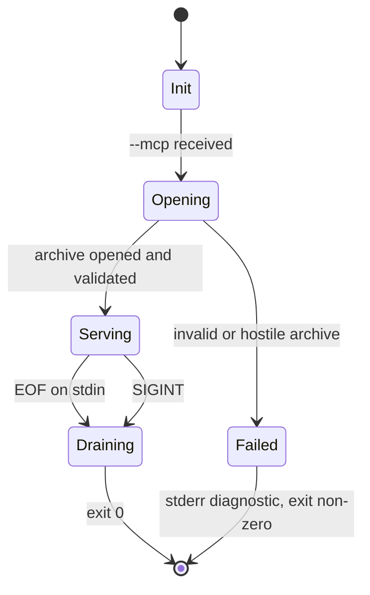
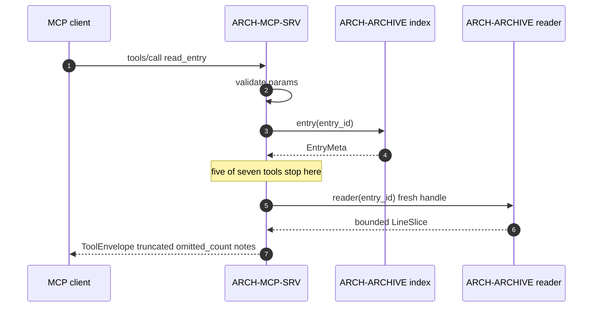

# 05 — `crates/mcp` design

Covers the server lifecycle, the no-lock concurrency model, the error model, the
`ArchiveStatus` contract, and the seven-tool surface assessment.

## 1. The tool surface

**Seven tools is right. Do not merge; do not add an eighth except `instructions`, which is not
a tool.**

| Tool | Answers | Backed by |
| --- | --- | --- |
| `archive_info` | Am I looking at the archive I think I am? | index + `identity()` |
| `list_entries` | What is here, with sizes? | index only |
| `find_entries` | Which paths match a pattern? No content, no sizes. | index only |
| `read_entry` | A bounded slice of one entry. | fresh reader per call |
| `grep_archive` | Content search, returning locators. | fresh reader per call |
| `entry_info` | Everything about one entry. | index + detect |
| `find_by_type` | Which paths are of this content type? | index + detect |

### Why not merge the three "what's in here" tools

`list_entries`, `find_entries`, and `find_by_type` are three routes to the same question. The
tempting fix is one tool with a `mode` parameter and a union-typed result.

**Rejected.** A union-typed result is strictly worse for an agent: it must read a schema
describing three shapes in order to use one, and the return type tells it nothing about which
shape arrived. Three cheap tools with three crisp return types is the better surface. Each maps
to exactly one capability.

**What was genuinely missing is a discriminator, not a tool.** Each description's first
sentence names the question it answers, so an agent can choose without trial and error.

### `archive_info` is the expensive call, and must say so

One SHA-256 over a bugreport routinely 100–800 MB. Its description must state that it is the
most expensive call, that it runs once per server, and that it is the call an agent makes
**first**. It is also the trust anchor for the whole session, so it is `EntryId`-addressed and
carries `computed_at_ms`.

### Result envelope — one shape, uniformly

```
schema_version : 1
tool           : "grep_archive"
status         : "ok" | "empty" | "not_found" | "unreadable"
data           : { ... tool-specific ... }
truncated      : bool
stopped_reason : null | "item_cap" | "match_cap" | "scan_budget" | "line_too_long" | "byte_budget"
omitted_count  : int >= 0
notes          : [ ... ]
```

**The last four are always present, never omitted.** A uniform envelope is what makes
`REQ-MCP-08` mechanically checkable: one test loops all seven tools and asserts the keys exist
and `status` is one of four values.

### The highest-value addition to the surface

**`byte_offset` on every `grep_archive` match.** Without it, an agent that greps a 682,951-line
entry and gets 50 matches must issue 50 more calls, each rescanning from the start. With it,
`read_entry(entry_id, byte_offset, …)` resumes. This is the difference between a usable and an
unusable tool on the reference archive.

### Addressing: `EntryId`, never path

Every tool addresses entries by `entry_id: u32`. **Paths are output, not input.** This removes
path traversal, encoding mismatches, duplicate entry names, and glob-vs-literal ambiguity in a
single move. It is a change to `REQ-MCP-ARC-04`'s wording — see
[`03` §5](./03-id-scheme.md#5-family-1--req-).

## 2. Lifecycle



| Stage | Behaviour |
| --- | --- |
| `Init` | Parse argv. `--mcp` selects server mode. `--verbose` sets stderr diagnostics. |
| `Opening` | `Archive::open` runs **before** the transport starts. |
| `Serving` | stdio JSON-RPC loop. Tools capability advertised; nothing else. |
| `Draining` | Graceful shutdown, exit 0. |
| `Failed` | Diagnostic to stderr, exit non-zero. **The stdio loop never starts.** |

### Decisions that were not obvious

- **stdout carries JSON-RPC frames and nothing else.** Any `println!` in `crates/mcp/**` is a
  build-blocking defect, enforced by a grep assertion in the test suite.
- **Open failure means no server.** A server that cannot see its archive must not answer
  `archive_info`. This is the exact failure `REQ-MCP-08` exists to prevent, and it is the one
  place where "no result" must not read as "empty result".
- **Advertise the `tools` capability only.** No `prompts`, no `resources`, no `logging`.
  Advertising a capability with no handler is a lie to the client.
- **EOF on stdin is exit 0.** This is what a client disconnect actually looks like. Treating it
  as an error produces false failures in every agent harness.
- **No progress notifications in v1.** `grep_archive` is the only slow call and is bounded by a
  scan budget instead. `rmcp`'s `notify_progress` adds protocol surface with no consumer.

### Logging

`tracing-subscriber` is absent offline, and `tracing` without a subscriber is inert. Diagnostics
go **directly to stderr** via `crates/mcp/src/diag.rs`, honouring `--verbose`.

This also **strengthens** the stdout-purity guarantee: `eprintln!` cannot reach stdout by
construction, whereas a misconfigured subscriber can. See
[`02` §4.5](./02-amendment-1.md#45-tracing-subscriber-absent--no-logging-framework-in-stage-1).

## 3. Concurrency — no lock anywhere



`ZipArchive<BufReader<File>>` is `!Sync` and needs `&mut self` to read an entry. Seven tools,
one process, an async runtime. The naive answer — `Arc<Mutex<ZipArchive>>` — serialises
everything and blocks the executor.

**Decision: split the archive into an immutable index and per-call handles.**

- At startup, walk the **central directory once** into `Arc<ArchiveIndex>`. No decompression.
- **Five of seven tools are pure functions over `&ArchiveIndex`** — `list_entries`,
  `find_entries`, `find_by_type`, `entry_info`, `archive_info`. They touch no handle and no
  lock, ever.
- **Two tools need bytes.** `read_entry` and `grep_archive` re-open the file per call and index
  by `EntryId`. Cost: one `open` plus a central-directory parse — milliseconds at 10k entries.
  Benefit: **no shared mutable state, no `Mutex`, no `RwLock`, no blocking.**
- Content reads run inside `tokio::task::spawn_blocking`. Mandatory, not optional.

**The server holds no lock of any kind.** This is a property of the design, not an
implementation detail, and it is what makes the concurrency story trivially correct.

`sha256` is computed **once per server lifetime**, memoised in a `OnceLock`, stamped
`computed_at_ms`. Hashing a 400 MB archive per call would cost seconds per agent turn.

## 4. Error model

Retrofitting this after seven tools ship means touching seven result shapes and every client.

### Domain to wire

`ArchiveError` (13 variants, [`04a`](./04a-core-archive-api.md#errorrs)) carries a **stable
machine `code`**. One function maps it:

| Class | Variants | Mapping |
| --- | --- | --- |
| **Transport** | `InvalidGlob`, `ConflictingRangeParams`, `PatternModeUnavailable` | JSON-RPC error via `ErrorData::invalid_params` |
| **Method** | unknown tool name | JSON-RPC method error |
| **Startup** | `Open`, `NotAZipArchive`, `LimitExceeded`, `Malformed` | stderr + exit non-zero; **never** an MCP response |
| **Domain** | `EntryNotFound`, `EntryIsDirectory`, `EntryEncrypted`, `UnsupportedCompression`, `UnreadableEntry`, `ByteRangeOutOfBounds`, `LineRangeOutOfBounds` | `CallToolResult { is_error: true, content: [structured JSON] }` |

Domain failures are returned as **tool errors, not transport errors**, because agent harnesses
handle tool errors far better and a structured body lets the agent recover — for example, with
the `entry_id` it should retry.

Every error body carries a stable `code`, a human `message`, and `data`. **The message is prose;
`code` is the contract.**

No `unwrap`, no `expect`, no panic in either crate.

## 5. `ArchiveStatus` — the `REQ-MCP-08` contract

`REQ-MCP-08` requires that a zero-match result stay distinguishable from a failure, an absent
section, and an unreadable section. It was unenforceable because `section_status` lives in a
**draft** document (`artifact-schemas.md` §2.2), reachable only through `DRAFT-REQ-ART-*`.

**Decision: promote a committed four-value enum.** It is defined in `crates/archive` — see
[`04b`](./04b-core-archive-types.md#archivestatus--why-it-lives-here) — and mapped onto the wire by
`crates/mcp`.

### Projection from the draft eight

| Draft `SectionStatus` | Committed `ArchiveStatus` |
| --- | --- |
| `ok` | `Ok` |
| `empty` | `Empty` |
| `not_found` | `NotFound` |
| `unreadable` | `Unreadable` |
| `skipped_user_build` | *arrives with `DRAFT-REQ-ART-*`* |
| `skipped_root_denied` | *arrives with `DRAFT-REQ-ART-*`* |
| `skipped_missing_source` | *arrives with `DRAFT-REQ-ART-*`* |
| `skipped_budget` | *arrives with `DRAFT-REQ-ART-*`* |

### The rule that matters

> A tool failure is **never** shaped like a successful empty result.
> `Empty` is reachable only when the tool completed and determined there is nothing.
> `NotFound` only when the addressed thing does not exist.
> `Unreadable` only when it exists and could not be read.

### The test matrix

For each of the seven tools, four cases:

| Case | Expected `status` | Fixture |
| --- | --- | --- |
| Success | `Ok` | normal archive |
| Zero matches | `Empty` | valid archive, pattern absent |
| Missing entry | `NotFound` | `entry_id` outside the index |
| Corrupt entry | `Unreadable` | valid central directory over a broken deflate stream |

The corrupt case is the one that catches the actual bug: a naive implementation that returns
`empty` when it could not read. Issue 5 in
[`06` §6](./06-hostile-archive.md#6-the-ten-fixtures) is the fixture that catches it.

## 6. Are `REQ-MCP-08` and `REQ-MCP-09` enforceable with no artifact schema behind them?

- **`REQ-MCP-08`: yes**, once the four-value `ArchiveStatus` is committed. The draft document
  stops being a dependency of a committed requirement.
- **`REQ-MCP-09`: no, as written.** It requires that a tool never return "a claim the
  corresponding artifact would not publish, including a causal claim linking a delta to its
  collector." Archive tools make **no claims and no deltas**, and there is no artifact behind
  them. The clause is vacuous against the committed seven. Split — the committed requirement
  keeps locator discipline, the causal-claim clause moves to
  `DRAFT-ARCH-MCP-TOOLS-ANALYSIS`. See
  [`01` §3.4](./01-decision-record.md#34-req-mcp-09--not-enforceable-for-raw-archive-tools-as-written).

Both questions have the same answer shape: **a committed requirement must not name a draft
concept.** That is rule 1 applied to requirement text rather than element status.

## 7. Enforceable guarantees

`REQ-MCP-04` is currently correct but only inspectable. **Add:** a test asserts the archive's
SHA-256 and mtime are unchanged after a full sweep of every tool.

`REQ-MCP-05` claims `verifymethod: test` for what is a design principle. **Replace** the
philosophical clause with the testable half: every tool has a non-empty description whose first
sentence states its cost class and bound, a schema with `additionalProperties: false`, and
`tools/list` returns exactly the committed set — asserted as a regression guard.

`REQ-MCP-11` is added to replace the lost philosophical clause with something an agent can
actually use: `initialize` carries `instructions`, at most 40 lines naming each tool, its cost
class, its bound, and the intended call order.