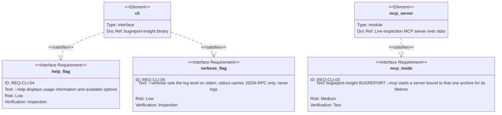

# Requirement diagram — command line

Two canvases: the three committed flags, and the seven deferred toggles plus the deferred analysis
command. The split is visible in the IDs rather than in a legend — `--mcp`, `--help`, and `--verbose`
are unprefixed, everything else carries `DRAFT-`.

Index and notation: [`index.md`](./index.md).

## Committed — three flags

`REQ-CLI-03` is satisfied by `mcp_server` rather than by `cli`, because the flag is the CLI's
contract but the behaviour it selects lives in the server crate. `cli` hands control over; it does not
implement the server.

## Draft — the analysis command and its toggles

```mermaid
requirementDiagram

    direction TB

    element cli {
        type: "interface"
        docRef: "bugreport-insight binary"
    }

    interfaceRequirement analyze_command {
        id: "DRAFT-REQ-CLI-01"
        text: "bugreport-insight BUGREPORT generates static analysis artifacts into .BUGREPORT/insight/"
        risk: high
        verifymethod: test
    }

    interfaceRequirement sys_toggle {
        id: "DRAFT-REQ-CLI-02"
        text: "--sys includes system analysis in the generated artifacts, default true"
        risk: medium
        verifymethod: test
    }

    interfaceRequirement apps_toggle {
        id: "DRAFT-REQ-CLI-06"
        text: "--apps includes apps analysis in the generated artifacts, default true"
        risk: medium
        verifymethod: test
    }

    interfaceRequirement anr_toggle {
        id: "DRAFT-REQ-CLI-07"
        text: "--anr includes ANR analysis in the generated artifacts, default true"
        risk: medium
        verifymethod: test
    }

    interfaceRequirement crash_toggle {
        id: "DRAFT-REQ-CLI-08"
        text: "--crash includes crash analysis in the generated artifacts, default true"
        risk: medium
        verifymethod: test
    }

    interfaceRequirement memory_toggle {
        id: "DRAFT-REQ-CLI-09"
        text: "--memory includes memory analysis in the generated artifacts, default true"
        risk: medium
        verifymethod: test
    }

    interfaceRequirement cpu_toggle {
        id: "DRAFT-REQ-CLI-10"
        text: "--cpu includes CPU analysis in the generated artifacts, default true"
        risk: medium
        verifymethod: test
    }

    interfaceRequirement no_prefix_toggle {
        id: "DRAFT-REQ-CLI-11"
        text: "--no-* disables one analysis type, e.g. --no-anr skips ANR analysis"
        risk: medium
        verifymethod: test
    }

    cli - satisfies -> analyze_command
    cli - satisfies -> sys_toggle
    cli - satisfies -> apps_toggle
    cli - satisfies -> anr_toggle
    cli - satisfies -> crash_toggle
    cli - satisfies -> memory_toggle
    cli - satisfies -> cpu_toggle
    cli - satisfies -> no_prefix_toggle
```

