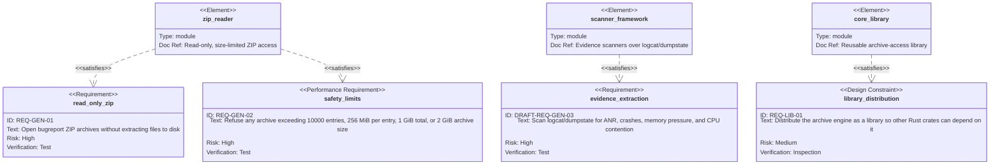

# Requirement diagram — core library

The archive-reading requirements and the one deferred scanning requirement. The reason the archive
half can ship ahead of the analyzers is visible here: `zip_reader` satisfies two committed
requirements and depends on nothing, while `scanner_framework` carries a `DRAFT-` ID because the only
requirement it serves is draft.

Index and notation: [`index.md`](./index.md).

The four numeric limits are stated once, in
[`../requirements.md`](../requirements.md#general). This diagram repeats them in abbreviated form
only so the node is self-describing in isolation; the specification is the authority.
