# Requirement diagram — draft artifacts

The artifact set and the requirement that produces it. This is the widest canvas in the set, at nine
requirement nodes, because one writer satisfies nine requirements with no internal dependency to
split on. If it becomes hard to read, split the eight per-artifact requirements into their own
canvas.

Every requirement here is draft, and so is every element on it. Nothing in the committed scope is
traceable into this file.

Index and notation: [`index.md`](./index.md).

```mermaid
requirementDiagram

    direction TB

    element artifact_writer {
        type: "module"
        docRef: "JSON/NDJSON/Markdown artifact generation"
    }

    requirement artifact_generation {
        id: "DRAFT-REQ-GEN-04"
        text: "Produce JSON/NDJSON findings, a Markdown README, a manifest, and session segmentation"
        risk: medium
        verifymethod: test
    }

    requirement readme_artifact {
        id: "DRAFT-REQ-ART-01"
        text: "README.md summarizes findings and further investigation steps"
        risk: medium
        verifymethod: inspection
    }

    requirement json_artifacts {
        id: "DRAFT-REQ-ART-02"
        text: "Generate system.json, apps.json, anr.json, crashes.json, memory.json, and cpu.json"
        risk: medium
        verifymethod: test
    }

    requirement system_artifact {
        id: "DRAFT-REQ-ART-03"
        text: "system.json establishes the canonical capture context, section status, and build-type gating every other artifact references"
        risk: high
        verifymethod: test
    }

    requirement apps_artifact {
        id: "DRAFT-REQ-ART-04"
        text: "apps.json separates installed packages from running processes, keyed on process_key rather than pid, with per-channel coverage"
        risk: medium
        verifymethod: test
    }

    requirement anr_artifact {
        id: "DRAFT-REQ-ART-05"
        text: "anr.json keys ANRs by incident, never promotes retained trace files to incidents, and labels every evidence item with its age"
        risk: high
        verifymethod: test
    }

    requirement crashes_artifact {
        id: "DRAFT-REQ-ART-06"
        text: "crashes.json names one authoritative channel for the headline count, keeps Java and native evidence separate, and reports the de-duplication split"
        risk: high
        verifymethod: test
    }

    requirement memory_artifact {
        id: "DRAFT-REQ-ART-07"
        text: "memory.json records the collector's own page-scanning cost and attributes swap growth to it rather than to the device"
        risk: high
        verifymethod: test
    }

    requirement cpu_artifact {
        id: "DRAFT-REQ-ART-08"
        text: "cpu.json separates windowed utilization from cumulative core counters and from contention, and carries each measurement's window and kind"
        risk: medium
        verifymethod: test
    }

    artifact_writer - satisfies -> artifact_generation
    artifact_writer - satisfies -> readme_artifact
    artifact_writer - satisfies -> json_artifacts
    artifact_writer - satisfies -> system_artifact
    artifact_writer - satisfies -> apps_artifact
    artifact_writer - satisfies -> anr_artifact
    artifact_writer - satisfies -> crashes_artifact
    artifact_writer - satisfies -> memory_artifact
    artifact_writer - satisfies -> cpu_artifact
```

The `DRAFT-` prefix on `DRAFT-REQ-GEN-04` is load-bearing and was once missing from this block; the
requirement is draft, and an unprefixed ID in a diagram would have asserted otherwise.

Field-level schemas for these artifacts are in
[`../draft/artifact-schemas/`](../draft/artifact-schemas/index.md).
