# Requirement diagram — MCP server

The ten committed server requirements. Every one is unprefixed: the server is in scope now, so none of
them is draft. `DRAFT-REQ-MCP-07`, the artifacts-as-resources capability, is the one exception and is
on the [MCP tools canvas](./req-mcp-tools.md) with the rest of the deferred tool surface.

Index and notation: [`index.md`](./index.md).

```mermaid
requirementDiagram

    direction TB

    element mcp_server {
        type: "module"
        docRef: "Live-inspection MCP server over stdio"
    }

    designConstraint crate_independence {
        id: "REQ-MCP-01"
        text: "The server is its own crate, a peer of cli, and not a mode compiled into the CLI binary"
        risk: medium
        verifymethod: inspection
    }

    designConstraint single_archive_scope {
        id: "REQ-MCP-02"
        text: "One server instance is bound to exactly one archive for its lifetime, with no way to open a second mid-session"
        risk: medium
        verifymethod: inspection
    }

    requirement mcp_read_only_archive {
        id: "REQ-MCP-03"
        text: "Read the archive in place under the same size and entry-count limits as REQ-GEN-01 and REQ-GEN-02"
        risk: high
        verifymethod: test
    }

    designConstraint read_only_tool_surface {
        id: "REQ-MCP-04"
        text: "No tool mutates the archive, any output directory, or any other state"
        risk: high
        verifymethod: inspection
    }

    interfaceRequirement tool_naming_and_typing {
        id: "REQ-MCP-05"
        text: "Every tool is named, described, and declared with a typed input schema and a documented result shape"
        risk: high
        verifymethod: test
    }

    performanceRequirement bounded_responses {
        id: "REQ-MCP-06"
        text: "Cap excerpts at 512 bytes, cap result sets at 200 items or 50 matches, and report what was omitted"
        risk: high
        verifymethod: test
    }

    requirement empty_is_not_error {
        id: "REQ-MCP-08"
        text: "A search that matched nothing succeeds and stays distinguishable from a failure, an absent entry, and an unreadable entry"
        risk: high
        verifymethod: test
    }

    requirement evidence_discipline {
        id: "REQ-MCP-09"
        text: "Return evidence as an entry_id locator with a bounded excerpt, never as a copy of the source"
        risk: high
        verifymethod: test
    }

    interfaceRequirement stdio_transport {
        id: "REQ-MCP-10"
        text: "Speak MCP over stdio; stdout carries JSON-RPC frames and nothing else, and diagnostics go to stderr"
        risk: medium
        verifymethod: test
    }

    interfaceRequirement initialize_instructions {
        id: "REQ-MCP-11"
        text: "The initialize response carries instructions of at most 40 lines naming each tool, its cost class, its bound, and the call order"
        risk: medium
        verifymethod: test
    }

    mcp_server - satisfies -> crate_independence
    mcp_server - satisfies -> single_archive_scope
    mcp_server - satisfies -> mcp_read_only_archive
    mcp_server - satisfies -> read_only_tool_surface
    mcp_server - satisfies -> tool_naming_and_typing
    mcp_server - satisfies -> bounded_responses
    mcp_server - satisfies -> empty_is_not_error
    mcp_server - satisfies -> evidence_discipline
    mcp_server - satisfies -> stdio_transport
    mcp_server - satisfies -> initialize_instructions
```

The numeric caps inside `REQ-MCP-06` are abbreviated here; the full set — 200 items, 50 matches,
32 MiB scanned per grep call, the five `stopped_reason` values, and the rule that all four envelope
fields are always present — is in
[`../requirements.md`](../requirements.md#mcp-server).
