# Requirement diagram — MCP tools

Two canvases. The first is the committed surface: the seven archive tools, each satisfied by both
`mcp_server` — because it is reachable over the protocol — and by `core_archive`, the capability
behind it. The second is the deferred surface: the analyzer tools, the resource surface, and the two
format/pattern extensions. Those carry `DRAFT-` IDs because the crates behind them are themselves
draft, so the boundary is visible in the ID rather than left to the reader to infer.

Index and notation: [`index.md`](./index.md).

## Committed — the seven archive tools

```mermaid
requirementDiagram

    direction TB

    element mcp_server {
        type: "module"
        docRef: "Live-inspection MCP server over stdio"
    }

    element core_archive {
        type: "module"
        docRef: "Read-only ZIP list, read, find, and grep"
    }

    interfaceRequirement archive_info {
        id: "REQ-MCP-ARC-01"
        text: "archive_info returns archive basename, size, sha256, entry count, format version, and main entry"
        risk: medium
        verifymethod: test
    }

    interfaceRequirement list_entries {
        id: "REQ-MCP-ARC-02"
        text: "list_entries lists ZIP entry paths and sizes, optionally scoped to one subtree prefix"
        risk: medium
        verifymethod: test
    }

    interfaceRequirement find_entries {
        id: "REQ-MCP-ARC-03"
        text: "find_entries filters entry paths by glob or literal and returns matching paths with no content"
        risk: medium
        verifymethod: test
    }

    interfaceRequirement read_entry {
        id: "REQ-MCP-ARC-04"
        text: "read_entry returns a bounded line or byte range of one entry, never the whole entry, always flagging truncation"
        risk: high
        verifymethod: test
    }

    performanceRequirement grep_archive {
        id: "REQ-MCP-ARC-05"
        text: "grep_archive returns matches as locators under an explicit match cap and entry scope, never as raw section text"
        risk: high
        verifymethod: test
    }

    interfaceRequirement entry_info {
        id: "REQ-MCP-ARC-06"
        text: "entry_info returns one entry's compressed and uncompressed size, compression method, mtime, detected content type, and nested-archive status"
        risk: medium
        verifymethod: test
    }

    interfaceRequirement find_by_type {
        id: "REQ-MCP-ARC-07"
        text: "find_by_type filters entries by detected content type and reports the basis for each identification, never guessing an unidentifiable entry"
        risk: medium
        verifymethod: test
    }

    mcp_server - satisfies -> archive_info
    mcp_server - satisfies -> list_entries
    mcp_server - satisfies -> find_entries
    mcp_server - satisfies -> read_entry
    mcp_server - satisfies -> grep_archive
    mcp_server - satisfies -> entry_info
    mcp_server - satisfies -> find_by_type

    core_archive - satisfies -> archive_info
    core_archive - satisfies -> list_entries
    core_archive - satisfies -> find_entries
    core_archive - satisfies -> read_entry
    core_archive - satisfies -> grep_archive
    core_archive - satisfies -> entry_info
    core_archive - satisfies -> find_by_type
```

Every one of the seven is addressed by `entry_id`, never by path, and none of them runs an analyzer.
Both constraints are stated once in
[`../requirements.md`](../requirements.md#mcp-tools).

## Draft — the deferred tool surface

```mermaid
requirementDiagram

    direction TB

    element mcp_server {
        type: "module"
        docRef: "Live-inspection MCP server over stdio"
    }

    element core_archive {
        type: "module"
        docRef: "Read-only ZIP list, read, find, and grep"
    }

    element analyzer_crates {
        type: "module"
        docRef: "Analyzer crates anr, apps, stacktrace, memory, cpu"
    }

    interfaceRequirement artifacts_as_resources {
        id: "DRAFT-REQ-MCP-07"
        text: "The generated artifacts, including README.md, are readable as MCP resources as written"
        risk: medium
        verifymethod: test
    }

    interfaceRequirement pattern_mode_regex {
        id: "DRAFT-REQ-MCP-ARC-08"
        text: "find_entries and grep_archive accept PatternMode Regex, refusing it by type today rather than falling back to literal"
        risk: medium
        verifymethod: test
    }

    interfaceRequirement multi_format_archives {
        id: "DRAFT-REQ-MCP-ARC-09"
        text: "The server may open TAR archives and nested ZIP entries in addition to the committed ZIP-only scope"
        risk: medium
        verifymethod: test
    }

    interfaceRequirement list_anr {
        id: "DRAFT-REQ-MCP-ANR-01"
        text: "list_anr returns ANR incidents keyed on incident rather than on a retained trace file"
        risk: high
        verifymethod: test
    }

    interfaceRequirement list_apps {
        id: "DRAFT-REQ-MCP-APP-01"
        text: "list_apps separates installed packages from running processes, keyed on process_key rather than pid"
        risk: medium
        verifymethod: test
    }

    interfaceRequirement list_crashes {
        id: "DRAFT-REQ-MCP-CRS-01"
        text: "list_crashes keeps Java and native crash evidence separate and reports the de-duplication split"
        risk: high
        verifymethod: test
    }

    interfaceRequirement list_memory {
        id: "DRAFT-REQ-MCP-MEM-01"
        text: "list_memory carries the collector's own scanning cost so a swap delta is not attributed to the device"
        risk: high
        verifymethod: test
    }

    interfaceRequirement list_cpu {
        id: "DRAFT-REQ-MCP-CPU-01"
        text: "list_cpu separates windowed utilization from cumulative core counters and from contention"
        risk: medium
        verifymethod: test
    }

    designConstraint no_unsupported_causal_claim {
        id: "DRAFT-REQ-MCP-TOOLS-ANALYSIS"
        text: "Analyzer tool results publish no causal claim linking a delta to its collector unless the corresponding artifact would publish it too"
        risk: high
        verifymethod: test
    }

    mcp_server - satisfies -> artifacts_as_resources
    mcp_server - satisfies -> list_anr
    mcp_server - satisfies -> list_apps
    mcp_server - satisfies -> list_crashes
    mcp_server - satisfies -> list_memory
    mcp_server - satisfies -> list_cpu

    core_archive - satisfies -> pattern_mode_regex
    core_archive - satisfies -> multi_format_archives

    analyzer_crates - satisfies -> list_anr
    analyzer_crates - satisfies -> list_apps
    analyzer_crates - satisfies -> list_crashes
    analyzer_crates - satisfies -> list_memory
    analyzer_crates - satisfies -> list_cpu
    analyzer_crates - satisfies -> no_unsupported_causal_claim
```

`DRAFT-REQ-MCP-TOOLS-ANALYSIS` is modelled as a `designConstraint` on `analyzer_crates` rather than
as a tool. It is a prohibition on how analyzer-backed results may be worded, and the committed
archive tools make no causal claims at all, so `core_archive` satisfies it vacuously and carries no
edge to it.
