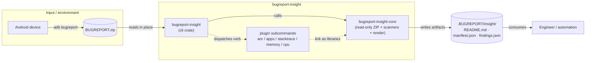
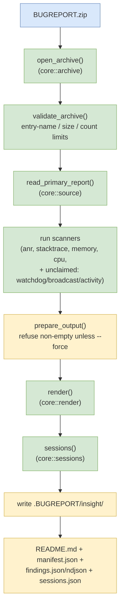
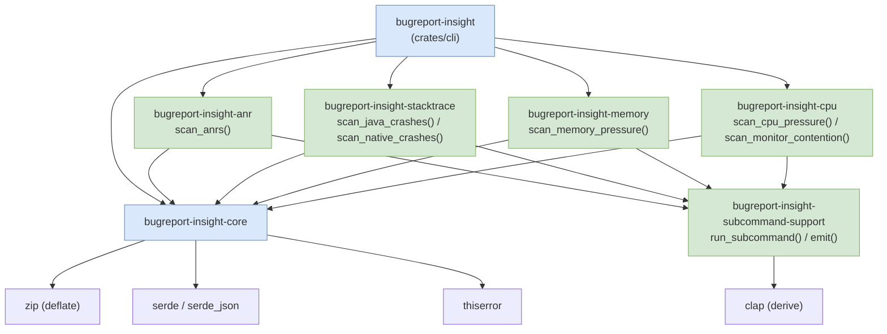

# bugreport-insight — Project Summary

## 1. Executive Summary

`bugreport-insight` is a Rust command-line tool that analyzes Android `adb bugreport` ZIP archives **without extracting them to disk**. It reads the archive in place, selects the primary bugreport text, runs a suite of pattern-based scanners over the logcat/dumpstate content, and writes a self-contained set of insight artifacts — machine-readable JSON/NDJSON plus a concise Markdown report — into a sibling `.BUGREPORT/insight/` directory.

The tool is a Cargo workspace of eight crates. A single `bugreport-insight` binary orchestrates everything, and five focused subcommand binaries (`anr`, `apps`, `stacktrace`, `memory`, `cpu`) are dispatched git/cargo-style so each topic can be queried independently. Every scanner is also published as a reusable library function, so third-party subcommands can compose them without reimplementation.

## 2. Architecture Overview

`bugreport-insight` is a read-only, single-binary-plus-plugins architecture. The CLI binary links a shared core library (read-only ZIP access, scanners, rendering) and a set of scanner libraries, and dispatches focused verbs to sibling binaries. It has no network access, no database, and no persistent server — it is a local analysis utility that turns one ZIP archive into a folder of findings.



### Key architectural facts

- **Read-only ZIP access** (`core/src/archive.rs`): the archive is opened with `zip::ZipArchive<BufReader<File>>` and its central directory is enumerated; no entry is ever extracted to disk.
- **Plugin dispatch** (`cli/src/plugin.rs`): `bugreport-insight <verb> ...` execs a sibling `bugreport-insight-<verb>` binary (looked up beside the current executable, then on `PATH`).
- **Shared rendering** (`core/src/render.rs`): one `render()` function writes the entire `insight/` artifact set.
- **Schema-versioned findings** (`core/src/model.rs`): every finding and artifact carries a `schema_version` field.

## 3. Processing Pipeline

The default invocation `bugreport-insight <BUGREPORT_ZIP>` runs a single left-to-right pipeline: open, validate, select source, scan, render.



### Step-by-step walkthrough

1. **Open** — `open_archive()` opens the file and wraps it in `ZipArchive` without writing anything.
2. **Validate** — `validate_archive()` rejects unsafe entry names (absolute paths, backslashes, non-normal path components) and archives exceeding `MAX_ENTRIES` (10,000), `MAX_ENTRY_BYTES` (256 MiB), or `MAX_TOTAL_BYTES` (1 GiB).
3. **Select source** — `read_primary_report()` prefers the entry named by `main_entry.txt` (the AOSP version 1.0+ format, which survives renaming); otherwise it picks the largest top-level `bugreport-*.txt` entry. The report is streamed with a `MAX_REPORT_BYTES` (128 MiB) cap.
4. **Scan** — `cli/src/report.rs::run()` composes findings from the `anr`, `stacktrace`, `memory`, and `cpu` scanner libraries, then appends `core`'s own "unclaimed" scanners (`watchdog`, `broadcast_latency`, `activity_timeline`).
5. **Prepare output** — `prepare_output()` derives the output directory from the input stem (`/tmp/pixel.zip` → `/tmp/.pixel/`) and refuses to overwrite a non-empty directory unless `--force` is passed.
6. **Render** — `render()` writes `findings.json`, `findings.ndjson`, `sessions.json`, one `logcat_<index>/metadata.json` per session, `manifest.json`, and a human-readable `README.md`.

## 4. Core Components

### 4.1 Crate map



### 4.2 Core modules (`crates/core/src/`)

| Module | Responsibility |
| --- | --- |
| `archive.rs` | `open_archive()`, `validate_archive()`; size/count/name safety limits |
| `source.rs` | `read_primary_report()`; selects the canonical bugreport text entry |
| `analyze.rs` | `open_report()`, `unclaimed_findings()`, `render_insight()`; top-level orchestration API |
| `render.rs` | `render()`; writes the full `insight/` artifact set |
| `model.rs` | `Finding`, `Evidence`, `Session`, `Manifest`, `AppInfo`, `Boundary`, `TimeRange` |
| `sessions.rs` | `sessions()`; segments logcat into reboot-aware sessions |
| `scanners/mod.rs` | shared helpers `find_all()`, `lookahead()`, `unique_sample()`, `MAX_EVIDENCE_PER_FINDING` |
| `scanners/activity.rs` | `scan_activity_timeline()` |
| `scanners/crash.rs` | `scan_watchdog()` |
| `scanners/performance.rs` | `scan_broadcast_latency()` |
| `error.rs` | `Error` enum (typed, `thiserror`) |
| `text.rs` | `bounded()`, `markdown_escape()`, `capitalize()` |

### 4.3 Scanner inventory

| Finding ID | Severity | Owner crate | Detection signal |
| --- | --- | --- | --- |
| `anr` | high | `subcommand-anr` | `ANR in <package>` + following `Reason:` line |
| `java_crash` | high | `subcommand-stacktrace` | `FATAL EXCEPTION` / `Process:` / exception class |
| `native_crash` | high | `subcommand-stacktrace` | text `tombstone_NN` entries under `FS/data/tombstones/` |
| `watchdog` | high | `core::scanners::crash` | `WATCHDOG KILLING SYSTEM PROCESS` / `system_server crash` |
| `memory_pressure` | medium | `subcommand-memory` | `am_low_memory`, `am_proc_died`, `am_proc_start` churn |
| `cpu_io_pressure` | medium | `subcommand-cpu` | `kswapd` / `kworker` / `mmcqd` CPU rows |
| `lock_contention` | medium | `subcommand-cpu` | `held by thread` in thread dumps |
| `monitor_contention` | medium | `subcommand-cpu` | `Long monitor contention … for Nms` |
| `broadcast_latency` | medium | `core::scanners::performance` | `BROADCAST_COMPLETION_LATENCY_REPORTED` over 3000 ms |
| `activity_timeline` | informational | `core::scanners::activity` | `am_focused_activity` transitions |

## 5. Finding & Artifact Contracts

### 5.1 Finding

Every scanner emits a schema-versioned `Finding` (serialized with `serde`):

| Field | Type | Notes |
| --- | --- | --- |
| `schema_version` | `u8` | currently `1` |
| `id` | `string` | e.g. `anr`, `native_crash` |
| `severity` | `string` | `high` \| `medium` \| `informational` |
| `title` | `string` | short human-readable title |
| `summary` | `string` | one-sentence interpretation |
| `evidence` | `Evidence[]` | bounded, source-attributed excerpts (max 10 per finding) |
| `metadata` | `BTreeMap<String, String>` | scanner-specific, e.g. `packages`, `occurrences`, `max_duration_ms` |

`Evidence` carries `source`, `line_start`, `line_end`, and a `bounded()` excerpt capped at 400 characters.

### 5.2 Artifacts written to `.BUGREPORT/insight/`

| File | Purpose |
| --- | --- |
| `README.md` | human-readable summary, findings, session table |
| `manifest.json` | run metadata: tool version, input archive, primary source, artifact list, session/reboot counts, severity counts |
| `findings.json` | complete pretty-printed finding array |
| `findings.ndjson` | one finding per line (streaming-friendly) |
| `sessions.json` | ordered session index |
| `logcat_<index>/metadata.json` | per-session machine-readable summary |

`manifest.json` reports `logcat_sessions` and `observed_reboot_boundaries` (which equals `sessions - 1`; a lower bound, not a lifetime reboot count).

## 6. Infrastructure & Deployment

There is no Dockerfile, Kubernetes manifest, or CI/CD configuration in the repository — this is a pure Rust CLI distributed as Cargo binaries.

- **Build**: `cargo build --workspace` (requires a Rust toolchain with `edition = "2024"`).
- **Run**: `cargo run -- <BUGREPORT_ZIP>`, or `cargo run -- <verb> <BUGREPORT_ZIP>` for a focused subcommand.
- **Install model**: the `bugreport-insight` binary plus its `bugreport-insight-<verb>` sibling binaries live together; the dispatcher resolves plugins beside its own executable, then on `PATH`.

## 7. Extension Patterns

### 7.1 Adding a finding scanner (in-core)

1. Add a `scan_*()` function in `crates/core/src/scanners/` returning `Vec<Finding>`.
2. Re-export it from `scanners/mod.rs`.
3. Include it in `analyze.rs::unclaimed_findings()` so it joins the default full report.
4. A scanner must tolerate missing sections and return zero findings rather than fail.

### 7.2 Adding a new subcommand (as a crate)

1. Create `crates/subcommand-<verb>` with a `lib.rs` (owning `scan_*()`) and a thin `main.rs`.
2. Depend on `bugreport-insight-core` (and `bugreport-insight-subcommand-support` for CLI/JSON plumbing).
3. In `main.rs`, call `run_subcommand("description", |cli| { … open_report + scan … })`.
4. Register the crate in the root `Cargo.toml` `members` and `[workspace.dependencies]`, and add the verb to `BUILTIN_SUBCOMMANDS` in `cli/src/plugin.rs`.

### 7.3 Third-party subcommands

Install a `bugreport-insight-<verb>` executable on `PATH` built against `bugreport-insight-core`; `bugreport-insight <verb> ...` finds and runs it automatically. `bugreport-insight help <verb>` shows its own `--help`.

## 8. Rules & Anti-Patterns

**Do**

- Treat bugreport ZIP entry names as untrusted metadata, never as output paths.
- Keep all archives and generated artifacts local (bugreports can contain sensitive data).
- Emit evidence with source line references so automation can locate the original text.
- Keep findings bounded (`MAX_EVIDENCE_PER_FINDING = 10`, 400-char excerpts).

**Don't**

- Never extract archive entries to disk.
- Never write outside the derived output directory.
- Never interpret findings as proof of root cause — they are evidence from a captured snapshot.
- Never include credentials, tokens, or connection strings in artifacts or docs.

## 9. Dependencies

| Crate | Version | Purpose |
| --- | --- | --- |
| `clap` | 4.5 (`derive`) | CLI argument parsing |
| `serde` / `serde_json` | 1.0 | serialization of findings and artifacts |
| `thiserror` | 2.0 | typed `Error` enum |
| `zip` | 2.2 (`deflate` only) | read-only ZIP archive access |

No async runtime, no database driver, no HTTP client.

## 10. Code Structure

```text
crates/
├── core/                        # bugreport-insight-core (no CLI dependency)
│   └── src/
│       ├── analyze.rs           # open_report / unclaimed_findings / render_insight
│       ├── archive.rs           # read-only ZIP + safety limits
│       ├── source.rs            # primary-report selection
│       ├── render.rs            # artifact rendering
│       ├── model.rs             # Finding / Evidence / Session / Manifest / AppInfo
│       ├── sessions.rs          # reboot-aware session segmentation
│       ├── error.rs             # Error enum
│       ├── text.rs              # bounded / markdown_escape / capitalize
│       └── scanners/
│           ├── mod.rs           # find_all / lookahead / unique_sample
│           ├── activity.rs      # scan_activity_timeline
│           ├── crash.rs         # scan_watchdog
│           └── performance.rs   # scan_broadcast_latency
├── cli/                         # bugreport-insight binary
│   └── src/
│       ├── main.rs              # arg parsing + plugin dispatch entry
│       ├── cli.rs               # Cli (clap derive)
│       ├── plugin.rs            # git/cargo-style subcommand dispatch
│       └── report.rs            # full-report scanner composition
├── subcommand-support/          # shared CLI/JSON plumbing
│   └── src/lib.rs               # run_subcommand / emit / report_error
├── subcommand-anr/              # ANR scanner + binary
├── subcommand-apps/             # app inventory scanner + binary
├── subcommand-stacktrace/       # Java/native crash + tombstone scanner + binary
├── subcommand-memory/           # memory-pressure scanner + binary
└── subcommand-cpu/              # CPU/I-O + monitor-contention scanner + binary
```

## 11. Roadmap (from `PLAN.md`, not yet implemented)

`PLAN.md` describes a broader target that this codebase has not yet implemented. The documentation above reflects **implemented behavior only**; the following remain aspirational:

- **`mcp` subcommand** — a stdio-transport Model Context Protocol server exposing `analyze_bugreport`, `analyze_dumpstate`, and `read_insight` tools.
- **`dumpstate` vendor extension** — streaming `dumpstate_board.bin` entries to a separately installed `bugreport-insight-dumpstate` executable.
- **`Scanner` trait** — a common trait behind all scanners (currently each scanner is a standalone function).
- **Richer session metadata** — per-session app/PID/crash/time-range data (currently sessions record boundaries and evidence only).
