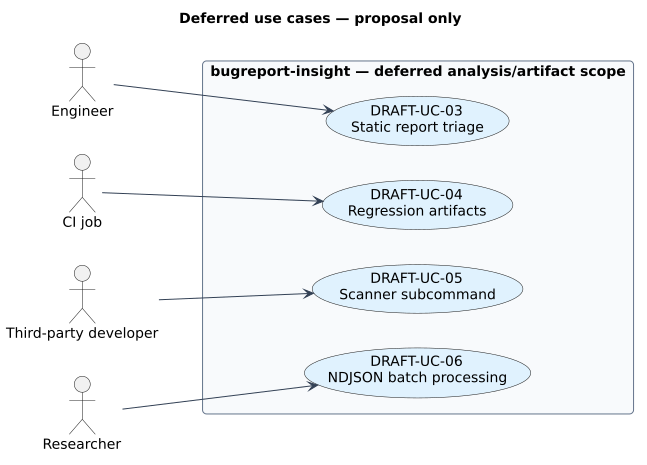

# Deferred use cases

> Proposal record.
> `DRAFT-UC-03` was superseded by committed [`UC-03`](../swe.1-requirements/01-use-cases.md#uc-03).
> The remaining cases are deferred.

[Edit diagram source](diagrams/01-use-cases.puml).

## Index

| ID | Use case | Actor | Status |
| --- | --- | --- | --- |
| [`DRAFT-UC-03`](../traceability.md#draft-uc-03) | Engineer triages from a static report (superseded by [`UC-03`](../swe.1-requirements/01-use-cases.md#uc-03)) | Engineer | Superseded |
| [`DRAFT-UC-04`](../traceability.md#draft-uc-04) | CI pipeline regression artifacts | CI job | 🚧 |
| [`DRAFT-UC-05`](../traceability.md#draft-uc-05) | Third-party scanner via subcommand | Third-party developer | 🚧 |
| [`DRAFT-UC-06`](../traceability.md#draft-uc-06) | Research batch-processing of NDJSON | Researcher | 🚧 |

## DRAFT-UC-03 · Engineer triages from a static report 🚧

This proposal use case is superseded by committed [`UC-03`](../swe.1-requirements/01-use-cases.md#uc-03).
Its original artifact intent is retained under `DRAFT-UC-03` for link stability.

## DRAFT-UC-04 · CI pipeline regression artifacts 🚧

CI runs a bugreport corpus through the CLI, retaining regression artifacts.
Blocked on the same artifact set as `DRAFT-UC-03`.

## DRAFT-UC-05 · Third-party scanner via subcommand 🚧

A developer adds a `bugreport-insight-<verb>` crate that the dispatcher runs.
Depends on draft analyzer framework/toggles.
The dropped `subcommand-*` approach leaves this shape unsettled; see [deferred architecture](./03-architecture.md#draft-elements).

## DRAFT-UC-06 · Research batch-processing of NDJSON 🚧

An analyst batch-processes a corpus and loads the NDJSON output into a warehouse.
Blocked on the artifact schema.

## Motivation

The original motivation now maps to committed [`UC-03`](../swe.1-requirements/01-use-cases.md#uc-03).
The motivation for a fast CLI without side effects and modular scanners belongs to this proposal: the server side retains `REQ-MCP-04`, while scanners remain `DRAFT-REQ-GEN-03`.
Current use cases are [UC-01 and UC-02](../swe.1-requirements/01-use-cases.md).
