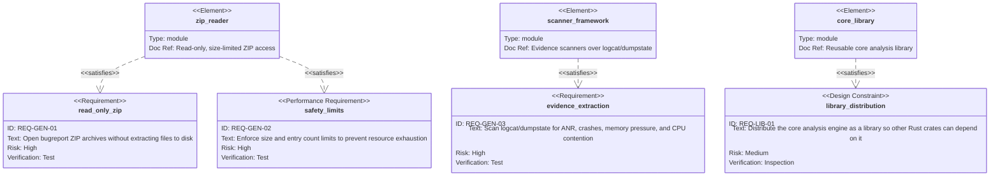

# Requirement Diagram

<!-- These diagrams trace each requirement in [requirements.md](./requirements.md) to the system element that satisfies it. Within each diagram the layout is top-down: elements sit at the top, the requirements they satisfy below, and the `risk` / `verifymethod` attributes of each requirement belong to it. -->

<!-- The set is split into four diagrams by concern. A single diagram carrying all 33 nodes is unreadable at
normal zoom — a 17-node version already rendered 3250 px wide — so partitioning by concern keeps each
canvas narrow while preserving the full 24-requirement / 24-relationship set. The Analysis Artifacts
canvas is now the widest, at nine requirement nodes; if it becomes hard to read, split the six
per-artifact requirements into their own concern diagram. -->

## Core Library

## Command-Line Interface

## Analysis Toggles

## Analysis Artifacts

## Requirement Index

Each ID below is an anchor target: the ID printed next to every requirement in
[requirements.md](./requirements.md) links back to its row here, and the row's own ID links forward to
the requirement text it visualizes. The `Diagram` column links to the section above that renders it.

| ID | Requirement | Satisfied by | Diagram | Risk | Verification |
| --- | --- | --- | --- | --- | --- |
| [`REQ-GEN-01`](./requirements.md#req-gen-01) | Read-only ZIP access | `zip_reader` | [Core library](#core-library) | high | test |
| [`REQ-GEN-02`](./requirements.md#req-gen-02) | Safety limits | `zip_reader` | [Core library](#core-library) | high | test |
| [`REQ-GEN-03`](./requirements.md#req-gen-03) | Evidence extraction | `scanner_framework` | [Core library](#core-library) | high | test |
| [`REQ-LIB-01`](./requirements.md#req-lib-01) | Library distribution | `core_library` | [Core library](#core-library) | medium | inspection |
| [`REQ-CLI-01`](./requirements.md#req-cli-01) | `BUGREPORT` analysis command | `cli` | [CLI](#command-line-interface) | high | test |
| [`REQ-CLI-03`](./requirements.md#req-cli-03) | `--mcp` server mode | `mcp_server` | [CLI](#command-line-interface) | medium | test |
| [`REQ-CLI-04`](./requirements.md#req-cli-04) | `--help` usage output | `cli` | [CLI](#command-line-interface) | low | inspection |
| [`REQ-CLI-05`](./requirements.md#req-cli-05) | `--verbose` logging | `cli` | [CLI](#command-line-interface) | low | inspection |
| [`REQ-CLI-02`](./requirements.md#req-cli-02) | `--sys` toggle | `cli` | [Toggles](#analysis-toggles) | medium | test |
| [`REQ-CLI-06`](./requirements.md#req-cli-06) | `--apps` toggle | `cli` | [Toggles](#analysis-toggles) | medium | test |
| [`REQ-CLI-07`](./requirements.md#req-cli-07) | `--anr` toggle | `cli` | [Toggles](#analysis-toggles) | medium | test |
| [`REQ-CLI-08`](./requirements.md#req-cli-08) | `--crash` toggle | `cli` | [Toggles](#analysis-toggles) | medium | test |
| [`REQ-CLI-09`](./requirements.md#req-cli-09) | `--memory` toggle | `cli` | [Toggles](#analysis-toggles) | medium | test |
| [`REQ-CLI-10`](./requirements.md#req-cli-10) | `--cpu` toggle | `cli` | [Toggles](#analysis-toggles) | medium | test |
| [`REQ-CLI-11`](./requirements.md#req-cli-11) | `--no-*` disable form | `cli` | [Toggles](#analysis-toggles) | medium | test |
| [`REQ-GEN-04`](./requirements.md#req-gen-04) | Artifact generation | `artifact_writer` | [Artifacts](#analysis-artifacts) | medium | test |
| [`REQ-ART-01`](./requirements.md#req-art-01) | `README.md` artifact | `artifact_writer` | [Artifacts](#analysis-artifacts) | medium | inspection |
| [`REQ-ART-02`](./requirements.md#req-art-02) | Per-analysis JSON artifacts | `artifact_writer` | [Artifacts](#analysis-artifacts) | medium | test |
| [`REQ-ART-03`](./requirements.md#req-art-03) | `system.json` capture context, section status, build-type gating | `artifact_writer` | [Artifacts](#analysis-artifacts) | high | test |
| [`REQ-ART-04`](./requirements.md#req-art-04) | `apps.json` packages vs. processes, `process_key` identity | `artifact_writer` | [Artifacts](#analysis-artifacts) | medium | test |
| [`REQ-ART-05`](./requirements.md#req-art-05) | `anr.json` incident keying and age labelling | `artifact_writer` | [Artifacts](#analysis-artifacts) | high | test |
| [`REQ-ART-06`](./requirements.md#req-art-06) | `crashes.json` authoritative channel and de-duplication split | `artifact_writer` | [Artifacts](#analysis-artifacts) | high | test |
| [`REQ-ART-07`](./requirements.md#req-art-07) | `memory.json` collector-cost attribution | `artifact_writer` | [Artifacts](#analysis-artifacts) | high | test |
| [`REQ-ART-08`](./requirements.md#req-art-08) | `cpu.json` utilization vs. core counters vs. contention | `artifact_writer` | [Artifacts](#analysis-artifacts) | medium | test |

## Notation

- `requirement` — functional behavior the tool must exhibit.
- `performanceRequirement` — a bound on resource usage, here the archive size and entry count limits.
- `designConstraint` — a rule that constrains how the system is built rather than what it does.
- `interfaceRequirement` — part of the user-facing command-line contract.
- `satisfies` — the element implements the requirement.
