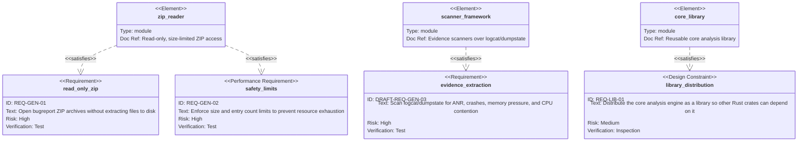
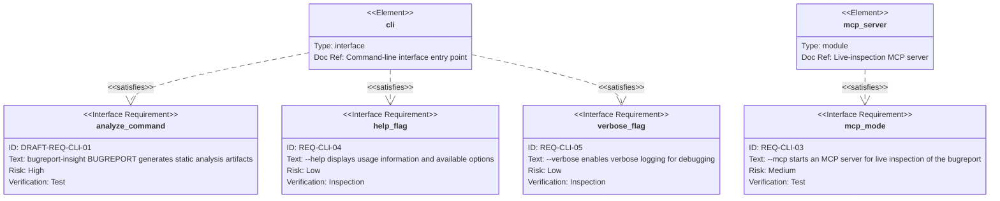

# Requirement Diagram

<!-- These diagrams trace each requirement in [requirements.md](./requirements.md) to the system element that satisfies it. Within each diagram the layout is top-down: elements sit at the top, the requirements they satisfy below, and the `risk` / `verifymethod` attributes of each requirement belong to it. -->

<!-- The set is split into six diagrams by concern. A single diagram carrying all 46 nodes is unreadable at
normal zoom — a 17-node version already rendered 3250 px wide — so partitioning by concern keeps each
canvas narrow while preserving the full 46-requirement / 58-relationship set. The Analysis Artifacts
canvas is the widest, at nine requirement nodes; if it becomes hard to read, split the six
per-artifact requirements into their own concern diagram.

The MCP tool requirements live on their own canvas rather than with the server requirements: merged,
the server canvas would carry 20 requirement nodes and blow the width budget this split exists to
avoid. Each tool is satisfied by both `mcp_server` (it is reachable over the protocol) and by the
capability behind it — `core_archive` for the ARC family, `analyzer_crates` for the five analyzer
families. -->

<!-- The `mcp_server` element appears on three canvases. The CLI canvas uses it to satisfy
`REQ-CLI-03`,
because the `--mcp` flag is the CLI's contract; the MCP Server canvas uses it to satisfy the
`REQ-MCP-*` set, because the server implementation is a separate concern from the flag that starts
it; the MCP Tools canvas uses it to satisfy every tool, because each tool is reachable over the
protocol. The server is in scope now, so none of the ten base MCP IDs carry the `DRAFT-` prefix. -->

## Core Library

## MCP Server

```mermaid
requirementDiagram

    direction TB

    element mcp_server {
        type: "module"
        docRef: "Live-inspection MCP server"
    }

    designConstraint crate_independence {
        id: "REQ-MCP-01"
        text: "The server is its own crate, a peer of cli, and not a mode compiled into the CLI binary"
        risk: medium
        verifymethod: inspection
    }

    designConstraint single_archive_scope {
        id: "REQ-MCP-02"
        text: "One server instance is bound to exactly one archive for its lifetime, with no way to open a second mid-session"
        risk: medium
        verifymethod: inspection
    }

    requirement mcp_read_only_archive {
        id: "REQ-MCP-03"
        text: "Read the archive in place under the same size and entry-count limits as the CLI"
        risk: high
        verifymethod: test
    }

    designConstraint read_only_tool_surface {
        id: "REQ-MCP-04"
        text: "No tool mutates the archive, the analysis output directory, or any other state"
        risk: high
        verifymethod: inspection
    }

    interfaceRequirement tool_naming_and_typing {
        id: "REQ-MCP-05"
        text: "Every tool is named, described, and declared with a typed input schema and a documented result shape"
        risk: high
        verifymethod: test
    }

    performanceRequirement bounded_responses {
        id: "REQ-MCP-06"
        text: "Cap excerpts at 512 bytes, cap result sets and report what was omitted, never return a section verbatim"
        risk: high
        verifymethod: test
    }

    interfaceRequirement artifacts_as_resources {
        id: "DRAFT-REQ-MCP-07"
        text: "The generated artifacts, including README.md, are readable as MCP resources as written"
        risk: medium
        verifymethod: test
    }

    requirement empty_is_not_error {
        id: "REQ-MCP-08"
        text: "A search that matched nothing succeeds and stays distinguishable from a failure, an absent section, and an unreadable section"
        risk: high
        verifymethod: test
    }

    requirement evidence_discipline {
        id: "REQ-MCP-09"
        text: "Return evidence as a locator, and never a claim the corresponding artifact would not publish"
        risk: high
        verifymethod: test
    }

    interfaceRequirement stdio_transport {
        id: "REQ-MCP-10"
        text: "Speak MCP over stdio; additional transports are optional and out of scope"
        risk: medium
        verifymethod: test
    }

    mcp_server - satisfies -> crate_independence
    mcp_server - satisfies -> single_archive_scope
    mcp_server - satisfies -> mcp_read_only_archive
    mcp_server - satisfies -> read_only_tool_surface
    mcp_server - satisfies -> tool_naming_and_typing
    mcp_server - satisfies -> bounded_responses
    mcp_server - satisfies -> artifacts_as_resources
    mcp_server - satisfies -> empty_is_not_error
    mcp_server - satisfies -> evidence_discipline
    mcp_server - satisfies -> stdio_transport
```

## MCP Tools

Each tool the server exposes carries its own ID, so the tool surface is traceable tool by tool rather
than as one block. The `ARC` family is backed by `core` archive access and is committed; the five
analyzer families are backed by crates that are themselves draft, so their IDs carry `DRAFT-`. That
boundary is visible in the ID rather than left to the reader to infer.

```mermaid
requirementDiagram

    direction TB

    element mcp_server {
        type: "module"
        docRef: "Live-inspection MCP server"
    }

    element core_archive {
        type: "module"
        docRef: "Read-only ZIP + TAR list/read/find/grep"
    }

    element analyzer_crates {
        type: "module"
        docRef: "Analyzer crates anr, apps, stacktrace, memory, cpu"
    }

    interfaceRequirement archive_info {
        id: "REQ-MCP-ARC-01"
        text: "archive_info returns archive basename, size, sha256, entry count, format version, and main entry"
        risk: medium
        verifymethod: test
    }

    interfaceRequirement list_entries {
        id: "REQ-MCP-ARC-02"
        text: "list_entries lists ZIP and TAR entry paths and sizes, optionally scoped to one subtree"
        risk: medium
        verifymethod: test
    }

    interfaceRequirement find_entries {
        id: "REQ-MCP-ARC-03"
        text: "find_entries filters entry paths by glob or regex and returns matching paths with no content"
        risk: medium
        verifymethod: test
    }

    interfaceRequirement read_entry {
        id: "REQ-MCP-ARC-04"
        text: "read_entry returns a bounded line or byte range of one entry, never the whole entry, always flagging truncation"
        risk: high
        verifymethod: test
    }

    performanceRequirement grep_archive {
        id: "REQ-MCP-ARC-05"
        text: "grep_archive returns matches as locators under an explicit match cap and entry scope, never as raw section text"
        risk: high
        verifymethod: test
    }

    interfaceRequirement entry_info {
        id: "REQ-MCP-ARC-06"
        text: "entry_info returns one entry's compressed and uncompressed size, compression method, mtime, detected content type, and nested-archive status"
        risk: medium
        verifymethod: test
    }

    interfaceRequirement find_by_type {
        id: "REQ-MCP-ARC-07"
        text: "find_by_type filters entries by detected content type and reports the basis for each identification, never guessing an unidentifiable entry"
        risk: medium
        verifymethod: test
    }

    interfaceRequirement list_anr {
        id: "DRAFT-REQ-MCP-ANR-01"
        text: "list_anr returns ANR incidents keyed on incident rather than on a retained trace file"
        risk: high
        verifymethod: test
    }

    interfaceRequirement list_apps {
        id: "DRAFT-REQ-MCP-APP-01"
        text: "list_apps separates installed packages from running processes, keyed on process_key rather than pid"
        risk: medium
        verifymethod: test
    }

    interfaceRequirement list_crashes {
        id: "DRAFT-REQ-MCP-CRS-01"
        text: "list_crashes keeps Java and native crash evidence separate and reports the de-duplication split"
        risk: high
        verifymethod: test
    }

    interfaceRequirement list_memory {
        id: "DRAFT-REQ-MCP-MEM-01"
        text: "list_memory carries the collector's own scanning cost so a swap delta is not attributed to the device"
        risk: high
        verifymethod: test
    }

    interfaceRequirement list_cpu {
        id: "DRAFT-REQ-MCP-CPU-01"
        text: "list_cpu separates windowed utilization from cumulative core counters and from contention"
        risk: medium
        verifymethod: test
    }

    mcp_server - satisfies -> archive_info
    mcp_server - satisfies -> list_entries
    mcp_server - satisfies -> find_entries
    mcp_server - satisfies -> read_entry
    mcp_server - satisfies -> grep_archive
    mcp_server - satisfies -> entry_info
    mcp_server - satisfies -> find_by_type
    mcp_server - satisfies -> list_anr
    mcp_server - satisfies -> list_apps
    mcp_server - satisfies -> list_crashes
    mcp_server - satisfies -> list_memory
    mcp_server - satisfies -> list_cpu

    core_archive - satisfies -> archive_info
    core_archive - satisfies -> list_entries
    core_archive - satisfies -> find_entries
    core_archive - satisfies -> read_entry
    core_archive - satisfies -> grep_archive
    core_archive - satisfies -> entry_info
    core_archive - satisfies -> find_by_type

    analyzer_crates - satisfies -> list_anr
    analyzer_crates - satisfies -> list_apps
    analyzer_crates - satisfies -> list_crashes
    analyzer_crates - satisfies -> list_memory
    analyzer_crates - satisfies -> list_cpu
```

## Command-Line Interface

## Analysis Toggles

```mermaid
requirementDiagram

    direction TB

    element cli {
        type: "interface"
        docRef: "Command-line interface entry point"
    }

    interfaceRequirement sys_toggle {
        id: "DRAFT-REQ-CLI-02"
        text: "--sys includes system analysis in the generated artifacts, default true"
        risk: medium
        verifymethod: test
    }

    interfaceRequirement apps_toggle {
        id: "DRAFT-REQ-CLI-06"
        text: "--apps includes apps analysis in the generated artifacts, default true"
        risk: medium
        verifymethod: test
    }

    interfaceRequirement anr_toggle {
        id: "DRAFT-REQ-CLI-07"
        text: "--anr includes ANR analysis in the generated artifacts, default true"
        risk: medium
        verifymethod: test
    }

    interfaceRequirement crash_toggle {
        id: "DRAFT-REQ-CLI-08"
        text: "--crash includes crash analysis in the generated artifacts, default true"
        risk: medium
        verifymethod: test
    }

    interfaceRequirement memory_toggle {
        id: "DRAFT-REQ-CLI-09"
        text: "--memory includes memory analysis in the generated artifacts, default true"
        risk: medium
        verifymethod: test
    }

    interfaceRequirement cpu_toggle {
        id: "DRAFT-REQ-CLI-10"
        text: "--cpu includes CPU analysis in the generated artifacts, default true"
        risk: medium
        verifymethod: test
    }

    interfaceRequirement no_prefix_toggle {
        id: "DRAFT-REQ-CLI-11"
        text: "--no-* disables a specific analysis type, e.g. --no-anr skips ANR analysis"
        risk: medium
        verifymethod: test
    }

    cli - satisfies -> sys_toggle
    cli - satisfies -> apps_toggle
    cli - satisfies -> anr_toggle
    cli - satisfies -> crash_toggle
    cli - satisfies -> memory_toggle
    cli - satisfies -> cpu_toggle
    cli - satisfies -> no_prefix_toggle
```

## Analysis Artifacts

```mermaid
requirementDiagram

    direction TB

    element artifact_writer {
        type: "module"
        docRef: "JSON/NDJSON/Markdown artifact generation"
    }

    requirement artifact_generation {
        id: "REQ-GEN-04"
        text: "Produce JSON/NDJSON findings, a Markdown README, a manifest, and session segmentation"
        risk: medium
        verifymethod: test
    }

    requirement readme_artifact {
        id: "DRAFT-REQ-ART-01"
        text: "README.md summarizes findings and further investigation steps"
        risk: medium
        verifymethod: inspection
    }

    requirement json_artifacts {
        id: "DRAFT-REQ-ART-02"
        text: "Generate system.json, apps.json, anr.json, crashes.json, memory.json, and cpu.json"
        risk: medium
        verifymethod: test
    }

    requirement system_artifact {
        id: "DRAFT-REQ-ART-03"
        text: "system.json establishes the canonical capture context, section status, and build-type gating every other artifact references"
        risk: high
        verifymethod: test
    }

    requirement apps_artifact {
        id: "DRAFT-REQ-ART-04"
        text: "apps.json separates installed packages from running processes, keyed on process_key rather than pid, with per-channel coverage"
        risk: medium
        verifymethod: test
    }

    requirement anr_artifact {
        id: "DRAFT-REQ-ART-05"
        text: "anr.json keys ANRs by incident, never promotes retained trace files to incidents, and labels every evidence item with its age"
        risk: high
        verifymethod: test
    }

    requirement crashes_artifact {
        id: "DRAFT-REQ-ART-06"
        text: "crashes.json names one authoritative channel for the headline count, keeps Java and native evidence separate, and reports the de-duplication split"
        risk: high
        verifymethod: test
    }

    requirement memory_artifact {
        id: "DRAFT-REQ-ART-07"
        text: "memory.json records the collector's own page-scanning cost and attributes swap growth to it rather than to the device"
        risk: high
        verifymethod: test
    }

    requirement cpu_artifact {
        id: "DRAFT-REQ-ART-08"
        text: "cpu.json separates windowed utilization from cumulative core counters and from contention, and carries each measurement's window and kind"
        risk: medium
        verifymethod: test
    }

    artifact_writer - satisfies -> artifact_generation
    artifact_writer - satisfies -> readme_artifact
    artifact_writer - satisfies -> json_artifacts
    artifact_writer - satisfies -> system_artifact
    artifact_writer - satisfies -> apps_artifact
    artifact_writer - satisfies -> anr_artifact
    artifact_writer - satisfies -> crashes_artifact
    artifact_writer - satisfies -> memory_artifact
    artifact_writer - satisfies -> cpu_artifact
```

## Requirement Index

Each ID below is an anchor target: the ID printed next to every requirement in
[requirements.md](./requirements.md) links back to its row here, and the row's own ID links forward to
the requirement text it visualizes. The `Diagram` column links to the section above that renders it.

An ID prefixed `DRAFT-` is not yet committed. The tool is not required to satisfy it, the
requirement may change or be withdrawn without notice, and a `DRAFT-` row is not traceability
evidence. 24 of the 46 rows are currently draft: everything the analyzers produce, plus the one
server capability not being implemented now. That is `DRAFT-REQ-GEN-03` (scanning files inside the
ZIP for signals), `DRAFT-REQ-GEN-04` and the eight
`DRAFT-REQ-ART-*` (the artifact set), `DRAFT-REQ-MCP-07` (exposing artifacts as resources, which is
not being implemented now), the five `DRAFT-REQ-MCP-{ANR,APP,CRS,MEM,CPU}-01` analyzer tools, and
`DRAFT-REQ-CLI-01`, `DRAFT-REQ-CLI-02`, and `DRAFT-REQ-CLI-06`
through `DRAFT-REQ-CLI-11` (the command and the toggles that drive analyzers).

What is **not** draft is what the tool needs before any analyzer exists: `REQ-GEN-01` and
`REQ-GEN-02` (reading and grepping the ZIP), `REQ-MCP-01` through `REQ-MCP-06` and `REQ-MCP-08`
through `REQ-MCP-10` (the server, including MCP-06, MCP-08, and MCP-09 that present artifact-defined
concepts — the interface is committed even where its content is not), the seven `REQ-MCP-ARC-*` tools
that read the archive directly, and `REQ-CLI-03` (`--mcp`), `REQ-CLI-04` (`--help`), `REQ-CLI-05`
(`--verbose`). `REQ-LIB-01` is the packaging commitment and is likewise not draft.

Note on the relationship count: the MCP Tools canvas carries two `satisfies` edges per tool — one
from `mcp_server`, because every tool is reachable over the protocol, and one from the capability
behind it. That is why 46 requirements yield 58 relationships rather than 46.

| ID | Requirement | Satisfied by | Diagram | Risk | Verification |
| --- | --- | --- | --- | --- | --- |
| [`REQ-GEN-01`](./requirements.md#req-gen-01) | Read-only ZIP access | `zip_reader` | [Core library](#core-library) | high | test |
| [`REQ-GEN-02`](./requirements.md#req-gen-02) | Safety limits | `zip_reader` | [Core library](#core-library) | high | test |
| [`DRAFT-REQ-GEN-03`](./requirements.md#draft-req-gen-03) | Evidence extraction | `scanner_framework` | [Core library](#core-library) | high | test |
| [`REQ-LIB-01`](./requirements.md#req-lib-01) | Library distribution | `core_library` | [Core library](#core-library) | medium | inspection |
| [`REQ-MCP-01`](./requirements.md#req-mcp-01) | Server is its own crate, a peer of `cli` | `mcp_server` | [MCP server](#mcp-server) | medium | inspection |
| [`REQ-MCP-02`](./requirements.md#req-mcp-02) | Single-archive scope for the server lifetime | `mcp_server` | [MCP server](#mcp-server) | medium | inspection |
| [`REQ-MCP-03`](./requirements.md#req-mcp-03) | Read-only archive access under the shared safety limits | `mcp_server` | [MCP server](#mcp-server) | high | test |
| [`REQ-MCP-04`](./requirements.md#req-mcp-04) | Read-only tool surface, no state mutation | `mcp_server` | [MCP server](#mcp-server) | high | inspection |
| [`REQ-MCP-05`](./requirements.md#req-mcp-05) | Tool naming, description, and typed input schema | `mcp_server` | [MCP server](#mcp-server) | high | test |
| [`REQ-MCP-06`](./requirements.md#req-mcp-06) | Bounded tool responses | `mcp_server` | [MCP server](#mcp-server) | high | test |
| [`DRAFT-REQ-MCP-07`](./requirements.md#draft-req-mcp-07) | Artifacts readable as MCP resources | `mcp_server` | [MCP server](#mcp-server) | medium | test |
| [`REQ-MCP-08`](./requirements.md#req-mcp-08) | Empty result distinguished from error and absence | `mcp_server` | [MCP server](#mcp-server) | high | test |
| [`REQ-MCP-09`](./requirements.md#req-mcp-09) | Evidence returned as a locator | `mcp_server` | [MCP server](#mcp-server) | high | test |
| [`REQ-MCP-10`](./requirements.md#req-mcp-10) | stdio transport | `mcp_server` | [MCP server](#mcp-server) | medium | test |
| [`REQ-MCP-ARC-01`](./requirements.md#req-mcp-arc-01) | `archive_info` — archive identity and shape | `core_archive` | [MCP tools](#mcp-tools) | medium | test |
| [`REQ-MCP-ARC-02`](./requirements.md#req-mcp-arc-02) | `list_entries` — list ZIP/TAR entry paths and sizes | `core_archive` | [MCP tools](#mcp-tools) | medium | test |
| [`REQ-MCP-ARC-03`](./requirements.md#req-mcp-arc-03) | `find_entries` — filter entry paths, no content | `core_archive` | [MCP tools](#mcp-tools) | medium | test |
| [`REQ-MCP-ARC-04`](./requirements.md#req-mcp-arc-04) | `read_entry` — bounded line or byte range of one entry | `core_archive` | [MCP tools](#mcp-tools) | high | test |
| [`REQ-MCP-ARC-05`](./requirements.md#req-mcp-arc-05) | `grep_archive` — content search returning locators | `core_archive` | [MCP tools](#mcp-tools) | high | test |
| [`REQ-MCP-ARC-06`](./requirements.md#req-mcp-arc-06) | `entry_info` — one entry's size, compression, mtime, type | `core_archive` | [MCP tools](#mcp-tools) | medium | test |
| [`REQ-MCP-ARC-07`](./requirements.md#req-mcp-arc-07) | `find_by_type` — filter entries by detected type | `core_archive` | [MCP tools](#mcp-tools) | medium | test |
| [`DRAFT-REQ-MCP-ANR-01`](./requirements.md#draft-req-mcp-anr-01) | `list_anr` — ANR incidents keyed on incident | `analyzer_crates` | [MCP tools](#mcp-tools) | high | test |
| [`DRAFT-REQ-MCP-APP-01`](./requirements.md#draft-req-mcp-app-01) | `list_apps` — packages vs. processes on `process_key` | `analyzer_crates` | [MCP tools](#mcp-tools) | medium | test |
| [`DRAFT-REQ-MCP-CRS-01`](./requirements.md#draft-req-mcp-crs-01) | `list_crashes` — Java and native kept separate | `analyzer_crates` | [MCP tools](#mcp-tools) | high | test |
| [`DRAFT-REQ-MCP-MEM-01`](./requirements.md#draft-req-mcp-mem-01) | `list_memory` — collector cost carried | `analyzer_crates` | [MCP tools](#mcp-tools) | high | test |
| [`DRAFT-REQ-MCP-CPU-01`](./requirements.md#draft-req-mcp-cpu-01) | `list_cpu` — utilization vs. counters vs. contention | `analyzer_crates` | [MCP tools](#mcp-tools) | medium | test |
| [`DRAFT-REQ-CLI-01`](./requirements.md#draft-req-cli-01) | `BUGREPORT` analysis command | `cli` | [CLI](#command-line-interface) | high | test |
| [`REQ-CLI-03`](./requirements.md#req-cli-03) | `--mcp` server mode | `mcp_server` | [CLI](#command-line-interface) | medium | test |
| [`REQ-CLI-04`](./requirements.md#req-cli-04) | `--help` usage output | `cli` | [CLI](#command-line-interface) | low | inspection |
| [`REQ-CLI-05`](./requirements.md#req-cli-05) | `--verbose` logging | `cli` | [CLI](#command-line-interface) | low | inspection |
| [`DRAFT-REQ-CLI-02`](./requirements.md#draft-req-cli-02) | `--sys` toggle | `cli` | [Toggles](#analysis-toggles) | medium | test |
| [`DRAFT-REQ-CLI-06`](./requirements.md#draft-req-cli-06) | `--apps` toggle | `cli` | [Toggles](#analysis-toggles) | medium | test |
| [`DRAFT-REQ-CLI-07`](./requirements.md#draft-req-cli-07) | `--anr` toggle | `cli` | [Toggles](#analysis-toggles) | medium | test |
| [`DRAFT-REQ-CLI-08`](./requirements.md#draft-req-cli-08) | `--crash` toggle | `cli` | [Toggles](#analysis-toggles) | medium | test |
| [`DRAFT-REQ-CLI-09`](./requirements.md#draft-req-cli-09) | `--memory` toggle | `cli` | [Toggles](#analysis-toggles) | medium | test |
| [`DRAFT-REQ-CLI-10`](./requirements.md#draft-req-cli-10) | `--cpu` toggle | `cli` | [Toggles](#analysis-toggles) | medium | test |
| [`DRAFT-REQ-CLI-11`](./requirements.md#draft-req-cli-11) | `--no-*` disable form | `cli` | [Toggles](#analysis-toggles) | medium | test |
| [`DRAFT-REQ-GEN-04`](./requirements.md#draft-req-gen-04) | Artifact generation | `artifact_writer` | [Artifacts](#analysis-artifacts) | medium | test |
| [`DRAFT-REQ-ART-01`](./requirements.md#draft-req-art-01) | `README.md` artifact | `artifact_writer` | [Artifacts](#analysis-artifacts) | medium | inspection |
| [`DRAFT-REQ-ART-02`](./requirements.md#draft-req-art-02) | Per-analysis JSON artifacts | `artifact_writer` | [Artifacts](#analysis-artifacts) | medium | test |
| [`DRAFT-REQ-ART-03`](./requirements.md#draft-req-art-03) | `system.json` capture context, section status, build-type gating | `artifact_writer` | [Artifacts](#analysis-artifacts) | high | test |
| [`DRAFT-REQ-ART-04`](./requirements.md#draft-req-art-04) | `apps.json` packages vs. processes, `process_key` identity | `artifact_writer` | [Artifacts](#analysis-artifacts) | medium | test |
| [`DRAFT-REQ-ART-05`](./requirements.md#draft-req-art-05) | `anr.json` incident keying and age labelling | `artifact_writer` | [Artifacts](#analysis-artifacts) | high | test |
| [`DRAFT-REQ-ART-06`](./requirements.md#draft-req-art-06) | `crashes.json` authoritative channel and de-duplication split | `artifact_writer` | [Artifacts](#analysis-artifacts) | high | test |
| [`DRAFT-REQ-ART-07`](./requirements.md#draft-req-art-07) | `memory.json` collector-cost attribution | `artifact_writer` | [Artifacts](#analysis-artifacts) | high | test |
| [`DRAFT-REQ-ART-08`](./requirements.md#draft-req-art-08) | `cpu.json` utilization vs. core counters vs. contention | `artifact_writer` | [Artifacts](#analysis-artifacts) | medium | test |

## Notation

- `requirement` — functional behavior the tool must exhibit.
- `performanceRequirement` — a bound on resource usage, here the archive size and entry count limits.
- `designConstraint` — a rule that constrains how the system is built rather than what it does.
- `interfaceRequirement` — part of a user-facing contract: the command line, or the MCP tool and resource surface an agent calls.
- `satisfies` — the element implements the requirement.
