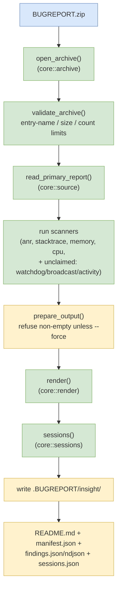

# Sequence Diagrams

## Processing Pipeline

The pipeline proceeds left‑to‑right, reading the bugreport, validating it, selecting the primary text entry, scanning for findings, and finally rendering the output artifacts.
