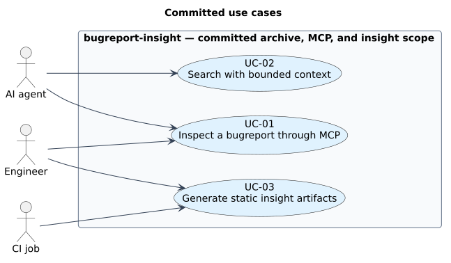

# Current use cases

Three cases define committed archive, MCP, and static-insight scope.
[Deferred cases](../proposals/01-use-cases.md) do not constrain this implementation.
[Traceability](../traceability.md#use-cases) joins cases and requirements both ways.

[Edit diagram source](diagrams/01-use-cases.puml).

## Index

| ID | Use case | Actor | Status |
| --- | --- | --- | --- |
| [`UC-01`](../traceability.md#uc-01) | Engineer inspects a bugreport through the MCP server | Engineer, AI agent | ✅ |
| [`UC-02`](../traceability.md#uc-02) | Agent searches a bugreport without exhausting its context | AI agent | ✅ |
| [`UC-03`](../traceability.md#uc-03) | Engineer generates static insight artifacts from a bugreport | Engineer, CI job | ✅ |

## Detail

### UC-01 · Engineer inspects a bugreport through the MCP server ✅

**Goal:** inspect archive evidence through an MCP client.
**Preconditions:** readable local bugreport ZIP and a client that launches the executable over stdio.
The archive remains unchanged by external programs for the session.
No analyzer output is required.

The engineer starts `bugreport-insight BUGREPORT --mcp` and queries the archive over MCP.
Using `core` without analyzers, the server identifies the archive, lists/filters entries, reads bounded slices and greps.
Committed requirements cover this workflow; `core` archive access shipped before analyzers.
Archive opening precedes transport; an inaccessible archive causes non-zero exit, never an apparently empty session.

**Main flow:** launch with one archive; complete initialization; discover tools; obtain entry IDs; inspect selected metadata/content; close client stdin when finished.
**Success outcome:** attributable evidence; unchanged input.
**Alternative outcomes:** invalid arguments fail usage; archive-open failure prevents the session; missing/unreadable entries report failures, not empty findings.
[Startup/process measures](../swe.5-component-and-integration-verification/02-integration-and-verification.md) identify checks and evidence gaps.

### UC-02 · Agent searches a bugreport without exhausting its context ✅

**Goal:** locate relevant evidence without consuming the archive wholesale.
**Preconditions:** initialized UC-01 session; question narrowable to entries, patterns or ranges.

An agent explores an archive whose main entry is tens of megabytes with a single line nearly 200,000 characters long.
It uses `find_by_type`/`find_entries` for discovery, `read_entry` for bounded slices and `grep_archive` for content search, returning locators instead of bulk text.
Constraints: `REQ-MCP-06` bounds results; `REQ-MCP-08` separates empty/error; `REQ-MCP-09` requires locators.

Match and coverage bounds use different units.
`omitted_count` counts withheld matches; early stops also leave *entries* unsearched.
`grep_archive` separately reports `scanned_entries`, `entries_in_scope`, `entries_not_searched`, `coverage_complete`; counts alone cannot prove full byte coverage.
A budget stop within the last entry can still report coverage_complete.
Read truncation and stop reason with the counts; see [search coverage](../swe.2-architecture/03-runtime-and-interactions.md#search-coverage).

**Main flow:** discover candidate IDs; search an explicit scope; inspect result status, stop flags and coverage; read a small range around a locator.
**Success outcome:** citable entry ID and line/byte position, with completeness limits.
**Alternative outcome:** early-stop absence is inconclusive; narrow/repeat the query.
A locator supports inspection, not a causal diagnosis of the device failure.

### UC-03 · Engineer generates static insight artifacts from a bugreport ✅

**Goal:** produce a bounded, evidence-linked triage report and six JSON artifacts from one Android bugreport ZIP.
**Preconditions:** one readable local ZIP archive and a writable sibling output location.

The engineer runs `bugreport-insight --insight BUGREPORT`.
The command reads the archive in place, runs all six analysis domains, and writes the seven schema-defined artifacts to `<parent>/.<file-stem>/insight/`.
An agent can then start `bugreport-insight BUGREPORT --mcp`, discover the generated artifacts with `resources/list`, and read their exact contents with `resources/read` under `REQ-MCP-07`.
Alternatively, start `bugreport-insight --mcp --insight FILE_OR_DIRECTORY` and use `list_bugreports`, `list_insights` and `read_insight` for confirmed in-memory analysis without publication.
Directory discovery is confined to immediate regular ZIP children and excludes symlinks; over-limit reports can use the explicitly raised `--force` policy.
Per-analyzer toggles remain deferred.

**Main flow:** validate arguments and archive limits; inspect the archive; derive system, apps, ANR, crash, memory, and CPU evidence; render the JSON artifacts and README; publish the complete output set.
**Success outcome:** seven parseable artifacts exist at the default path; each finding has bounded evidence and reports uncertainty or missing coverage; the input ZIP is byte-identical.
**Alternative outcomes:** usage errors exit 2; unreadable archives, analysis errors, and output conflicts exit 1; failed generation does not publish a partial artifact set.
