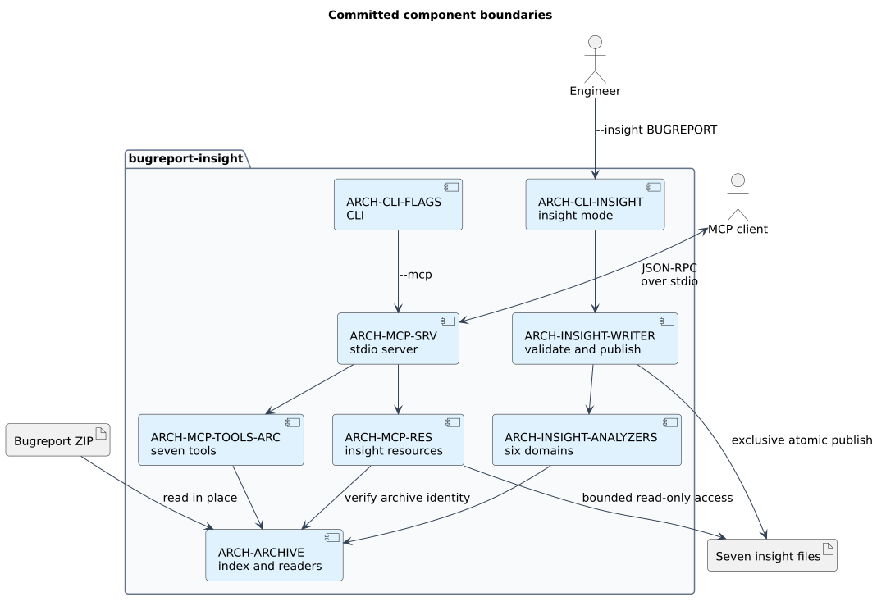

# Context and boundaries

The product opens Android bugreport ZIPs in place, serving read-only archive/insight tools over MCP stdio or generating seven static insight artifacts.
The CLI, MCP server and reusable core library are separate workspace packages.
Ordinary MCP binds one archive; combined insight mode binds one archive or an immediate-child directory catalog and never expands that scope.
Static insight runs six analyzers in core and publishes only the sibling artifact directory.
There is no database, network transport or archive-member extraction directory.
[Requirements](../swe.1-requirements/02-software-requirements.md) define obligations; [proposals](../proposals/index.md) isolate deferred specialized analyzer MCP and batch work.

[Edit diagram source](diagrams/01-context.puml).
This diagram shows ordinary single-archive MCP and standalone publication; the combined insight provider is described in [components](02-components-and-dependencies.md#combined-mcp-and-insight-scope).

MCP stdout is the protocol channel; insight writes no stdout payload, and diagnostics use stderr.
[Runtime interactions](./03-runtime-and-interactions.md) explain startup, request dispatch and shutdown.
[Components](./02-components-and-dependencies.md) define ARCH IDs and dependencies; [decisions](../decisions/index.md) explain significant choices.
The archive must stay unchanged externally: opening indexes metadata and pins its source file; later readers use independent logical positions over that descriptor.
External writes are not isolated by a snapshot.

## Operating assumptions and quality tradeoffs

| Assumption or constraint | Architectural consequence | Failure or review boundary |
| --- | --- | --- |
| Local client process can read the archive | CLI validates arguments; core opens before MCP transport | Startup failure uses stderr; no apparently empty session |
| The indexed ZIP stays unchanged externally | Immutable metadata is shared while content readers retain independent positions over a pinned source | External mutation can invalidate IDs/offsets; no snapshot guarantee |
| Agent context and archive work must be bounded | Separate discovery, metadata, reads and search; return locators and stop metadata | Current excerpt and scan-bound discrepancies remain in the requirement register |
| Deflated ZIP entries decompress sequentially | Independent readers replay to late offsets | Bounded retention implies neither constant time nor bounded total result memory |
| Tools are invoked from an async stdio service | Core/handler work stays synchronous in current dispatch | Hash/read/search can occupy the executor; no latency guarantee |

[Independent-reader rationale](../decisions/0003-independent-readers.md) explains the rejected shared cursor.
[Seven-tool rationale](../decisions/0002-seven-tools-and-entry-identity.md) explains discovery and addressing.
Limits and external mutation boundaries are detailed in [archive safety](../swe.3-detailed-design/04-archive-safety.md).
