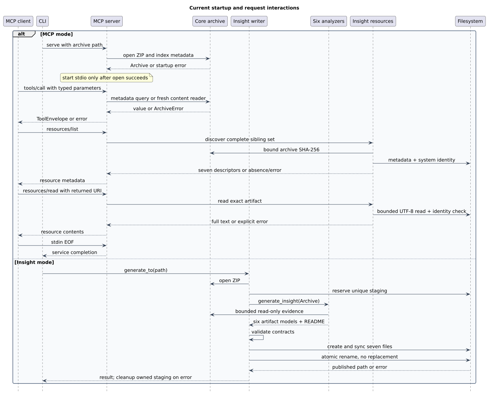

# Runtime and interactions

## Startup and shutdown

[CLI main](../../crates/cli/src/main.rs) parses flags and validates mode/archive arguments.
[MCP serve](../../crates/mcp/src/server.rs) opens the archive before starting rmcp stdio.
Startup open failure cannot appear as an empty successful query.
The service advertises tools, tool-list-change support and initialization instructions.
stdin EOF normally ends the service successfully.
Ordinary stdin EOF exits successfully before or after initialization.
Transport startup, IO, broken-stdout, and server-task failures produce stage-specific stderr diagnostics and exit nonzero.
On Unix, the MCP server monitors stdout for a closed response pipe because rmcp may otherwise complete the service task without propagating a failed response write.
Individual request errors remain scoped to their request, so subsequent valid requests can continue in the same session.
These modules implement no explicit application SIGINT/draining.

[Edit diagram source](diagrams/03-runtime.puml).
This sequence covers ordinary archive MCP and standalone publication; [combined sessions](#combined-insight-session) add confined discovery and in-memory analysis.

## Shared state and actual IO

An immutable index and shared digest cache sit behind `Arc<Archive>`.
Content operations use independent ZIP parsers and logical cursors over one pinned read-only source descriptor.
A short-held mutex makes each descriptor seek/read pair atomic while each cursor tracks its own position.
Pathname replacement cannot redirect content or hashing to another file; writes to the same underlying file remain visible.
Grep retains up to eight process-local continuations behind a handler mutex; each owns an independent decoder worker, with no shared ZIP cursor.
Other archive handlers remain stateless; confirmation wrappers share a bounded pending-request pool, and resources use a separate bounded pool.
Insight has a separate mutex-protected cache of compiled static parser patterns.
The adapter invokes synchronous handlers directly; it does not use spawn_blocking.
Independent logical positions prevent cross-reader cursor interference; descriptor IO serialization does not prove nonblocking async execution.

| Tool | IO performed |
| --- | --- |
| list_entries, find_entries | Index metadata only; no entry decompression |
| archive_info | After confirmation: stored-file SHA-256 when requested and uncached, plus repeated bounded marker-entry reads |
| entry_info | Index metadata and up to 8 KiB decompressed detection sample |
| find_by_type | Detection samples across files; bounded explicit failures and sample coverage accompany matches |
| read_entry | Fresh reader; replay to line/byte offset then bounded returned content |
| grep_archive | Sequential content scan through selected entries |

[ToolHandler and registry](../../crates/mcp/src/registry.rs) isolate tool logic from rmcp.
[Detailed MCP design](../swe.3-detailed-design/03-mcp-server.md) owns parameter, result and error shapes.

## Search coverage

`grep_archive` returns bounded pages with client response_budget, scan_budget and max_matches, plus an opaque next_cursor when work or pending matches remain.
The [page contract](../swe.3-detailed-design/03-mcp-server.md#search-pages) owns fields, defaults, errors and cursor lifecycle.
Core ScanSession retains the active decoder, carry bytes and partial line; a parked worker allows the ZIP parser borrow to survive calls safely, and reads only on demand.
Each page consumes at most its source-byte budget, including terminators and discarded long-line tails; previous-page carry is not charged again.
This does not bound internal decoder work or CPU time.
Matching requires a complete line; lines exceeding 1 MiB are explicitly skipped and counted, allowing later lines to be searched without claiming complete coverage.
Directories are completed without reads, encrypted entries are explicit gaps, and actual decode/CRC/safety failures remain errors.
Coverage is cumulative and true only at scope/delivery exhaustion with no skipped entries/lines; a partially read sole/final entry cannot establish complete coverage.
An empty page with a cursor means no matches returned yet, not no matches anywhere.
omitted_count counts discarded observed matches, never unknown matches or matches deferred to the next page; grep pagination therefore keeps it zero.
Excerpt-only clipping can coexist with complete search coverage.
[ADR 0009](../decisions/0009-client-search-budgets-and-pagination.md) records the approved policy and bounded state ownership.

## Static insight generation

[`ARCH-CLI-INSIGHT`](02-components-and-dependencies.md#arch-cli-insight) selects a single-report path independently of MCP.
The CLI requires `--insight BUGREPORT`, rejects an accompanying positional archive, and passes the input path to `bugreport-insight-core`.

Core opens the ZIP through [`ARCH-ARCHIVE`](02-components-and-dependencies.md#arch-archive), then runs all six analysis domains through [`ARCH-INSIGHT-ANALYZERS`](02-components-and-dependencies.md#arch-insight-analyzers).
Analyzers read archive entries in place and build structured evidence and artifact models; they do not write output files.

[`ARCH-INSIGHT-WRITER`](02-components-and-dependencies.md#arch-insight-writer) renders six JSON artifacts and the README into a unique staging directory inside the sibling `.<file-stem>/` root.
After all artifacts are complete, it publishes the directory as `<parent>/.<file-stem>/insight/` using a same-filesystem directory rename.
An existing destination fails without overwrite; unsuccessful runs remove their staging output and leave no final partial artifact set.

For standalone insight, the CLI writes progress and failure diagnostics to stderr and returns zero only after publication succeeds.
Argument errors return 2; archive, analysis, and filesystem errors return 1.
The input archive is never an output target.

## Insight resource reads

`ARCH-MCP-RES` locates the complete sibling artifact set using the bound archive path, independently of the ZIP entry namespace.
`resources/list` requires confirmation, then verifies regular directories/files, per-file size and the system artifact's stored-file SHA-256 before returning seven metadata descriptors.
Missing output returns an empty list; a present but incomplete/unreadable/mismatched set is an error.
`resources/read` requires its own confirmation, then matches an exact SHA-bound URI and returns the full UTF-8 file after checking identity and the 64 MiB actual-read ceiling.
The provider never generates or modifies files, so an output published later can be discovered by listing again without restarting MCP.
The adapter runs resource filesystem/JSON work through `spawn_blocking`; it maps provider errors to MCP resource-not-found or internal errors.
There are no subscriptions, list-change notifications or mutable resource operations.
Current-protocol responses carry private cache scope and zero TTL; the SDK adapts metadata for older clients.

## Collection query outcomes

ARCH-MCP-TOOLS-ARC applies [ADR 0010](../decisions/0010-empty-results-and-detection-failures.md): completed misses are Empty; capped or incompletely classified collections are partial Ok.
Type detection attempts every file through independent readers, excludes directories, and retains bounded failures rather than silently skipping them.
Coverage describes detection samples, while ARCH-MCP-SRV preserves separate direct-entry domain errors and session continuity.
[MCP outcome design](../swe.3-detailed-design/03-mcp-server.md#collection-outcomes-and-detection-coverage) owns fields, caps and stop-reason precedence.

## Range and subtree boundaries

MCP validates range endpoints before obtaining an entry reader, then calls core partial-range operations under [ADR 0012](../decisions/0012-range-boundaries-and-subtree-filters.md).
Available content survives normal EOF, while decoder/CRC/safety failures propagate through the existing error channel.
Subtree listing matches index paths at slash segment boundaries without reading content or changing entry identity.

## Approval before content IO

Initialization and tools/list return metadata without hashing the stored ZIP or reading entry payloads.
The registry checks an exact request-bound confirmation before archive_info, entry_info, find_by_type, read_entry or any grep_archive page enters its handler.
The adapter similarly checks each resource request before scheduling provider work; list_entries/find_entries use the existing index immediately.
A first request returns cost/token metadata without execution; an explicit matching retry consumes one token and runs the existing operation, which may still fail validation or reading.
The existing interaction diagram depicts the execution branch after a request is admitted; [detailed confirmation design](../swe.3-detailed-design/03-mcp-server.md#content-io-confirmation) owns the additional preview/retry exchange.
Approval is never inherited by a later call/page, and previewing a grep continuation does not reserve or refresh its independently expiring cursor.
Byte estimates distinguish hash input, decoded source and output size; none promises elapsed time, decoder CPU or physical IO.

## Combined insight session

With `--mcp --insight PATH`, startup constructs a file or confined immediate-directory catalog before starting transport.
`list_bugreports` reads candidate ZIP metadata; `list_insights` and `read_insight` pass through request confirmation before in-memory analysis or artifact access.
The shared provider retains at most one generated report and 64 MiB aggregate artifact text; selecting another report replaces that cache.
A continuation must retain its source digest and the cached generated set; changed-source or evicted-set errors require a new byte-zero read.
No output-stage or publication state machine runs in combined mode.
A CLI-selected resource policy is reused for each candidate; limit errors remain explicit and do not grant permission to open a parent or arbitrary path.
