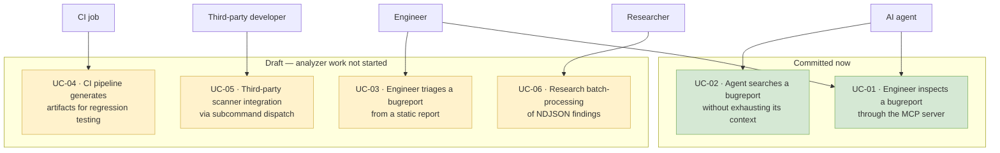

# Use Case Diagram

Each use case carries an ID and names the requirements it realizes, so this diagram is traceable into
[`requirement-diagram.md`](./requirement-diagram.md) and [`traceability-matrix.md`](./traceability-matrix.md).
A `(DRAFT)` marker means the use case is only realized by `DRAFT-`-prefixed requirements and is not
being built now. The 🚧/✅ columns repeat that status for scanning.

## Use Cases

| ID | Use case | Actor | Requirements | Status |
| --- | --- | --- | --- | --- |
| [`UC-01`](./traceability-matrix.md#uc-01) | Engineer inspects a bugreport through the MCP server | Engineer | `REQ-MCP-01` … `10`, `REQ-MCP-ARC-01` … `07`, `REQ-GEN-01`, `REQ-GEN-02`, `REQ-CLI-03` | ✅ |
| [`UC-02`](./traceability-matrix.md#uc-02) | Agent searches a bugreport without exhausting its context | AI agent | `REQ-MCP-ARC-04`, `REQ-MCP-ARC-05`, `REQ-MCP-ARC-06`, `REQ-MCP-ARC-07`, `REQ-MCP-06`, `REQ-MCP-08`, `REQ-MCP-09` | ✅ |
| [`UC-03`](./traceability-matrix.md#uc-03) | Engineer triages a bugreport from a static report | Engineer | `DRAFT-REQ-CLI-01`, `DRAFT-REQ-GEN-04`, `DRAFT-REQ-ART-01` … `08` | 🚧 |
| [`UC-04`](./traceability-matrix.md#uc-04) | CI pipeline generates artifacts for regression testing | CI job | `DRAFT-REQ-CLI-01`, `DRAFT-REQ-GEN-04`, `DRAFT-REQ-ART-02` | 🚧 |
| [`UC-05`](./traceability-matrix.md#uc-05) | Third-party scanner integration via subcommand dispatch | Third-party developer | `DRAFT-REQ-GEN-03`, `DRAFT-REQ-CLI-02`, `DRAFT-REQ-CLI-06` … `11` | 🚧 |
| [`UC-06`](./traceability-matrix.md#uc-06) | Research batch-processing of NDJSON findings | Researcher | `DRAFT-REQ-GEN-04`, `DRAFT-REQ-ART-02` | 🚧 |

## Detail

### UC-01 · Engineer inspects a bugreport through the MCP server ✅

The engineer starts `bugreport-insight BUGREPORT --mcp` and queries the archive over MCP. The server
answers from `core`'s archive access without running a single analyzer: it identifies the archive,
lists and filters entries, reads bounded slices, and greps. This is the use case the committed
requirements fully cover, and it is why `core`'s archive half can ship ahead of the analyzers.

### UC-02 · Agent searches a bugreport without exhausting its context ✅

An agent explores an archive whose main entry is tens of megabytes with a single line nearly 200,000
characters long. It calls `find_by_type` and `find_entries` to learn the shape cheaply, `read_entry`
for bounded slices, and `grep_archive` for content search — each returning locators rather than bulk
text. The bounds that make this use case survivable are `REQ-MCP-06` (every result bounded),
`REQ-MCP-08` (an empty result is not an error), and `REQ-MCP-09` (evidence as a locator).

### UC-03 · Engineer triages a bugreport from a static report 🚧

The engineer runs the CLI once and reads a Markdown report plus JSON artifacts. Entirely dependent
on the artifact set, which is still being designed.

### UC-04 · CI pipeline generates artifacts for regression testing 🚧

A CI job invokes the CLI over a corpus of bugreports and retains the artifacts as a regression
baseline. Blocked on the same artifact set as UC-03.

### UC-05 · Third-party scanner integration via subcommand dispatch 🚧

A developer adds a `bugreport-insight-<verb>` crate that the dispatcher runs. Depends on the
analyzer framework and the toggles that select it, all draft.

### UC-06 · Research batch-processing of NDJSON findings 🚧

An analyst batch-processes a corpus and loads the NDJSON output into a warehouse. Blocked on the
artifact schema.

## What These Use Cases Motivate

The committed pair — UC-01 and UC-02 — motivates the requirements that are committed: a read-only,
size-limited ZIP reader (`REQ-GEN-01`, `REQ-GEN-02`) and an MCP server whose every response is bounded
(`REQ-MCP-06`). The draft four motivate the analyzer framework and the artifact set, which are not
being built.

The original version of this document also motivated "a fast, no-side-effects CLI and a modular
scanner architecture." Both halves of that are draft: the no-side-effects property survives as
`REQ-MCP-04` on the server side, and the modular scanner architecture is `DRAFT-REQ-GEN-03`.