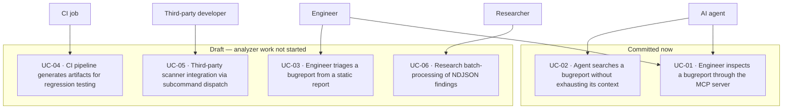

# Use cases

Each use case carries an ID and names the requirements it realizes, so it is traceable into
[`diagrams/index.md`](./diagrams/index.md) and
[`traceability-matrix.md`](./traceability-matrix.md). A `(DRAFT)` marker means the use case is only
realized by `DRAFT-`-prefixed requirements and is not being built now; the diagram groups carry the
same distinction, so the status is visible twice rather than needing a legend.

<!-- `usecaseDiagram` is the correct UML type for this view, but mermaid-svg 0.7.0 — the project's
     syntax gate — rejects it with "unknown diagram type". Rendered as `flowchart` instead. See
     design/09-open-items.md §4. -->

## Index

| ID | Use case | Actor | Status |
| --- | --- | --- | --- |
| [`UC-01`](./traceability-matrix.md#uc-01) | Engineer inspects a bugreport through the MCP server | Engineer, AI agent | ✅ |
| [`UC-02`](./traceability-matrix.md#uc-02) | Agent searches a bugreport without exhausting its context | AI agent | ✅ |
| [`DRAFT-UC-03`](./traceability-matrix.md#draft-uc-03) | Engineer triages from a static report | Engineer | 🚧 |
| [`DRAFT-UC-04`](./traceability-matrix.md#draft-uc-04) | CI pipeline regression artifacts | CI job | 🚧 |
| [`DRAFT-UC-05`](./traceability-matrix.md#draft-uc-05) | Third-party scanner via subcommand | Third-party developer | 🚧 |
| [`DRAFT-UC-06`](./traceability-matrix.md#draft-uc-06) | Research batch-processing of NDJSON | Researcher | 🚧 |

## Detail

### UC-01 · Engineer inspects a bugreport through the MCP server ✅

The engineer starts `bugreport-insight BUGREPORT --mcp` and queries the archive over MCP. The server
answers from `core`'s archive access without running a single analyzer: it identifies the archive,
lists and filters entries, reads bounded slices, and greps. This is the use case the committed
requirements fully cover, and it is why `core`'s archive half shipped ahead of the analyzers. The
archive is opened before the transport starts, so a server that cannot see its archive exits
non-zero rather than answering as though it were empty.

### UC-02 · Agent searches a bugreport without exhausting its context ✅

An agent explores an archive whose main entry is tens of megabytes with a single line nearly 200,000
characters long. It calls `find_by_type` and `find_entries` to learn the shape cheaply, `read_entry`
for bounded slices, and `grep_archive` for content search — each returning locators rather than bulk
text. The bounds that make this use case survivable are `REQ-MCP-06` (every result bounded),
`REQ-MCP-08` (an empty result is not an error), and `REQ-MCP-09` (evidence as a locator).

The two bounds that make it survivable are not the same number. `omitted_count` counts withheld
matches; when a scan budget stops early, whole *entries* go unsearched, which is a different quantity.
`grep_archive` therefore reports coverage separately — `scanned_entries`, `entries_in_scope`,
`entries_not_searched`, `coverage_complete` — so a zero result reads as provisional rather than as a
fact about the archive. See [`architecture.md` §6.5](./architecture.md#65-bounded-never-silently-truncated).

## DRAFT-UC-03 · Engineer triages from a static report 🚧

The engineer runs the CLI once and reads a Markdown report plus JSON artifacts. Entirely dependent
on the artifact set, which is still being designed. See
[`draft/requirements.md`](./draft/requirements.md#draft-req-art-02).

## DRAFT-UC-04 · CI pipeline regression artifacts 🚧

A CI job invokes the CLI over a corpus of bugreports and retains the artifacts as a regression
baseline. Blocked on the same artifact set as `DRAFT-UC-03`.

## DRAFT-UC-05 · Third-party scanner via subcommand 🚧

A developer adds a `bugreport-insight-<verb>` crate that the dispatcher runs. Depends on the
analyzer framework and the toggles that select it, all draft. Note that the `subcommand-*` crate
approach was dropped — see [`architecture.md` §3.2](./architecture.md#32-draft--recorded-not-built) —
so this use case's shape is not settled.

## DRAFT-UC-06 · Research batch-processing of NDJSON 🚧

An analyst batch-processes a corpus and loads the NDJSON output into a warehouse. Blocked on the
artifact schema.

## What these use cases motivate

The committed pair — `UC-01` and `UC-02` — motivates the requirements that are committed: a read-only,
size-limited ZIP reader (`REQ-GEN-01`, `REQ-GEN-02`) and an MCP server whose every response is bounded
(`REQ-MCP-06`). The draft four motivate the analyzer framework and the artifact set, which are not
being built.

An earlier version of this document also motivated "a fast, no-side-effects CLI and a modular scanner
architecture". Both halves of that are draft: the no-side-effects property survives as `REQ-MCP-04` on
the server side, and the modular scanner architecture is `DRAFT-REQ-GEN-03`.
